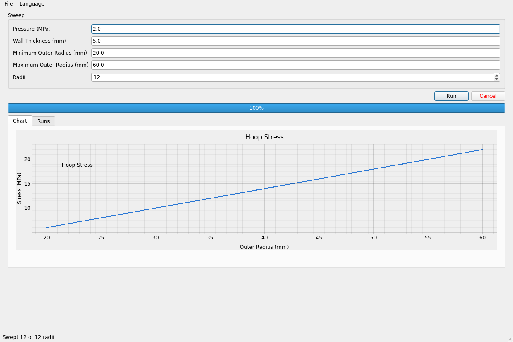
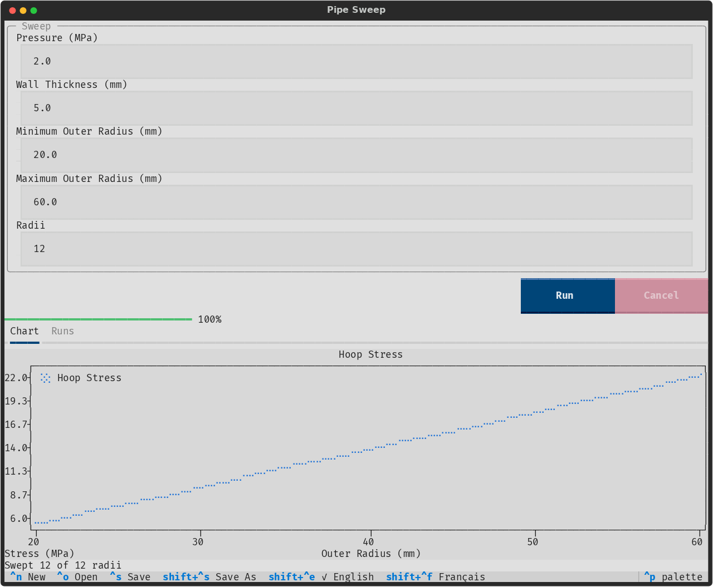
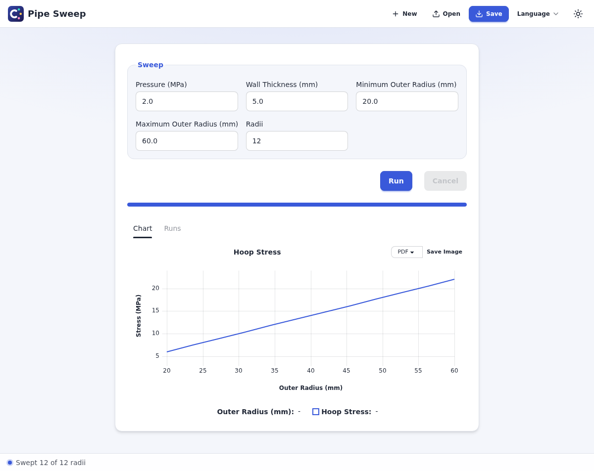
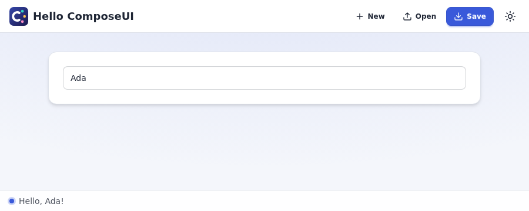

<h1>
  <picture>
    <source media="(prefers-color-scheme: dark)" srcset="https://raw.githubusercontent.com/ehmoussi/composeui/main/docs/_static/composeui-logo-dark.svg">
    
  </picture>
</h1>

Turn a Python script into an app that your colleagues can use. ComposeUI is for the data
scientists and simulation engineers who know Python, and want to put a form, a chart, or a
"Run" button around their work.

**No GUI toolkit, HTML, or JavaScript to learn. Just Python.**

You describe the screen in plain Python classes: the inputs, the tables, the charts. ComposeUI
draws it, and the same code runs in three places:

| A desktop window ([Qt](https://pypi.org/project/QtPy/)) | A terminal ([Textual](https://textual.textualize.io/)) | A web page ([Starlette](https://www.starlette.io/), [htmx](https://htmx.org/)) |
| --- | --- | --- |
|  |  |  |
| For an app on your own computer | For a remote computer or a cluster, over SSH | For your team, in their browsers |

> **Status:** early-stage / pre-alpha. The API can still change in any release.

## What you can build

- **The input form of a simulation.** Fields, choices, and checks that tell the
  user what is wrong before the run starts
  ([Building views](https://ehmoussi.github.io/composeui/user-guide/building-views.html)).
- **A front end for a solver.** Run a long computation or an external program in the
  background, with a progress bar, its output, and a "Cancel" button
  ([Running work in threads](https://ehmoussi.github.io/composeui/user-guide/threads.html)).
- **A dashboard from a dataframe.** Filters, metrics, charts, a map, and a table of a pandas or
  Polars frame, with a download of the rows shown
  ([Dashboards from a dataframe](https://ehmoussi.github.io/composeui/user-guide/dashboards.html)).
- **Results that you can explore.** Line and scatter charts, Matplotlib figures, and tables of
  a million rows that the user sorts and filters
  ([Charts](https://ehmoussi.github.io/composeui/user-guide/charts.html),
  [Tables](https://ehmoussi.github.io/composeui/user-guide/tables.html)).
- **Studies that you save and open again.** The File menu saves all the inputs of the app in
  one file, so a user can come back to a study, or send it to a colleague.

## Installation

Requires Python >= 3.9. Install ComposeUI from PyPI with the extras of the backends that you
want, for example the web and Qt backends:

```bash
uv add "composeui[web,pyside6]"     # or: pip install "composeui[web,pyside6]"
```

Each extra adds a backend or a feature:

| Extra | Installs | For |
| --- | --- | --- |
| `web` | Starlette, uvicorn | The web backend, the default |
| `pyside6` | PySide6 | The Qt backend, a desktop window |
| `tui` | Textual | The Textual backend, a terminal |
| `report` | Matplotlib | The report images of charts |
| `terminal-images` | textual-image | [Images](https://ehmoussi.github.io/composeui/user-guide/widgets.html#image) in pixels on Textual, on Python 3.12 or later |
| `reload` | watchfiles | Faster reloads in development |

To try ComposeUI and its example apps, clone the repository and install every extra:

```bash
git clone https://github.com/ehmoussi/composeui
cd composeui
uv sync --all-extras
```

To choose extras, give them all in one command, for example
`uv sync --extra web --extra pyside6`. Each `uv sync` removes the extras that it does not
name, so a second `uv sync --extra tui` would remove the web and Qt backends.

## Quickstart

A minimal window with a text input. As you type your name, the status bar greets you:

```python
from attrs import Factory

from composeui.core.view import InputView, MainView, define_view


@define_view
class GreetingInputView(InputView):
    def __attrs_post_init__(self) -> None:
        super().__attrs_post_init__()
        self.placeholder = "Type your name..."
        self.text_edited.connect(self._on_name_changed)

    # `main_view` is injected automatically because it's a requested parameter.
    def _on_name_changed(self, text: str, *, main_view: MainView) -> None:
        main_view.status_bar.show_message(f"Hello, {text}!" if text else "")


@define_view
class HelloMainView(MainView):
    app_title = "Hello ComposeUI"
    extension = ".hello"  # the file type of its studies, which the File menu saves

    greeting: GreetingInputView = Factory(GreetingInputView)
```

Save it as `hello.py`, and run it with one of the backends. Each backend needs its extra:

```bash
uv run composeui run hello.py                     # a web page, the default: the web extra
uv run composeui run hello.py --backend qt        # a window: the pyside6 extra
uv run composeui run hello.py --backend textual   # a terminal: the tui extra
```

With `pip`, leave out `uv run`. The web backend serves the page at http://127.0.0.1:8000. The
app reloads each time that you save the file.

The command imports only the backend that you choose. It gives the options after the file to
the app, and `composeui run hello.py --help` lists them. To run an app without the command, or
to serve it to other users, read
[Running the app](https://ehmoussi.github.io/composeui/user-guide/running-the-app.html).



### Next steps

1. Read the [core concepts](https://ehmoussi.github.io/composeui/user-guide/core-concepts.html)
   of the user guide: views, signals, the model, and studies.
2. Build a form with its layout and its checks, in
   [Building views](https://ehmoussi.github.io/composeui/user-guide/building-views.html).
3. To turn an analysis into a dashboard, follow
   [Dashboards from a dataframe](https://ehmoussi.github.io/composeui/user-guide/dashboards.html):
   filters of a frame's columns, metrics, a chart, a table, and a download.
4. Run the example apps, in the order of the
   [examples guide](https://ehmoussi.github.io/composeui/examples-guide.html#where-to-start).
   The first,
   [`src/examples/pipeform.py`](https://github.com/ehmoussi/composeui/blob/main/src/examples/pipeform.py),
   has forms, radio groups, a check box, a read-only table, checks, and a File menu that
   saves and opens:
   `uv run python -m examples.pipeform --backend qt`, or `textual`, or `web`.

## Build with your coding agent

ComposeUI ships a skill for coding agents, such as Claude Code: a `SKILL.md` file with the
rules that keep an app correct on every backend. Install it in your project, then ask your
agent for the app that you need, for example:

> Build a ComposeUI app with a form for the parameters of my solver. A "Run" button runs the
> solver with a progress bar, and a chart plots the results.

[Using a coding agent](https://ehmoussi.github.io/composeui/user-guide/coding-agents.html) says
how to install the skill.

## Why ComposeUI

- **Plain Python, no GUI code.** A screen is a class with typed fields. You do not create
  widgets or connect them by hand.
- **Set a value, and the screen follows.** When your code sets `view.text = "..."`, the screen
  shows the new text. You never call `update()` or `refresh()`.
- **Write the app once.** Start as a web page for your team, and run the same app as a
  desktop window or in a terminal, with one option: `--backend`.
- **Test it without a screen.** The state of the app is plain Python objects, so your tests
  set inputs and read results without a window or a browser
  ([Testing your app](https://ehmoussi.github.io/composeui/user-guide/testing.html)).

## When to use it

- **Choose ComposeUI** to put an app around a computation or a dataset, when it must show
  as a desktop window, in a terminal, or in a browser, or may move from one to another later.
  It also suits an app whose inputs must be saved as a file and checked by tests.
- **Compared with Streamlit,** the screen is made of explicit classes that keep their state,
  and nothing runs the script again on each change. The same app also runs as a desktop
  window or in a terminal.
- **Compared with Qt, Textual, or a web framework alone,** the app gives up the widgets
  that only one toolkit has, and keeps one code base for the three.
- **Not yet** for an app that needs a stable API, or a widget that is still missing, such
  as a context menu or a wizard (see
  [`ROADMAP.md`](https://github.com/ehmoussi/composeui/blob/main/ROADMAP.md)).

For software developers: ComposeUI is an MVVM layer. The views are typed
[`attrs`](https://www.attrs.org/) classes, the view-models of MVVM, and a renderer binds each
one to a widget of the backend
([how ComposeUI maps to MVVM](https://ehmoussi.github.io/composeui/user-guide/core-concepts.html#how-composeui-maps-to-mvvm)).

## Documentation

The documentation site, at https://ehmoussi.github.io/composeui/, has the guides below, a
widget catalog, and the API reference.

- The [user guide](https://ehmoussi.github.io/composeui/user-guide.html) explains how to build
  an app. It covers the views, their layout, forms and their checks, reactive methods,
  dashboards from a dataframe, and the widgets. It also covers pages, tabs, dialogs, tables, charts,
  [maps](https://ehmoussi.github.io/composeui/user-guide/maps.html), threads, SQLite models, CSV
  imports, and translations. It ends with the differences between the backends, testing an app,
  and a skill for coding agents.
- The [examples guide](https://ehmoussi.github.io/composeui/examples-guide.html) says what each
  example app shows, and how to run it.
- The [technical guide](https://ehmoussi.github.io/composeui/technical-guide.html) explains how
  ComposeUI works inside, and how to develop it: the architecture, how to add a widget or a
  backend, the tests, and the checks.
- [`CHANGELOG.md`](https://github.com/ehmoussi/composeui/blob/main/CHANGELOG.md) lists the
  changes of each release.
- [`ROADMAP.md`](https://github.com/ehmoussi/composeui/blob/main/ROADMAP.md) lists the work that
  is left.

## License

MIT, see [`LICENSE`](https://github.com/ehmoussi/composeui/blob/main/LICENSE).
