# Examples guide

The example apps in [`src/examples/`](../src/examples/) show ComposeUI's features in
complete apps. This guide says what each example shows, and how to run it. Each section
has a screenshot of the example on each backend that shows it. The
[user guide](user-guide.md) explains each feature. The examples are not in the wheel:
run them from a clone of the repository.

## Contents

- [Run an example](#run-an-example)
- [Overview](#overview)
- [Where to start](#where-to-start)
- [Pipe form](#pipe-form)
- [Markdown viewer](#markdown-viewer)
- [Task view](#task-view)
- [Pipe chart](#pipe-chart)
- [Pipe catalogue](#pipe-catalogue)
- [Pipe sweep](#pipe-sweep)
- [Large table](#large-table)
- [Uber pickups](#uber-pickups)
- [Uber pickups on a dataframe](#uber-pickups-on-a-dataframe)
- [Batman](#batman)
- [Web hello](#web-hello)
- [Textual demo](#textual-demo)

## Run an example

Clone the repository, and install in it the extras of the backends that you want (see the
[README](../README.md#installation)). Then run an example as a module:

```bash
uv run python -m examples.pipeform --backend qt
```

`--backend` takes `qt`, `textual`, or `web`. Without `--backend`, the `COMPOSEUI_BACKEND`
environment variable picks the backend. Without both, each example starts its own default
backend, which the [overview](#overview) gives. `--help` lists the other
options, such as `--language` and `-f FILE`.

## Overview

| Example | Default backend | Shows |
| --- | --- | --- |
| [`pipeform.py`](../src/examples/pipeform.py) | web | Forms, validation, pages, a menu, a confirm dialog, Markdown help, a French translation |
| [`markdownviewer.py`](../src/examples/markdownviewer.py) | web | A Markdown view, a file path input, an option of the app's own, no File menu |
| [`taskview.py`](../src/examples/taskview.py) | web | Jobs in threads, metrics, a progress bar, a step chart, an expander, a button and a link in a table's cells, a French translation |
| [`pipechart.py`](../src/examples/pipechart.py) | qt | Line and scatter charts, a reference line, tabs, a table, check boxes and comboboxes in a table's cells, colored, marked and disabled cells, cells spanning rows, a header group, row headers |
| [`pipecatalogue.py`](../src/examples/pipecatalogue.py) | web | A SQLite model, a sidebar, a list of views, a tree, resizable panes, a form dialog, a date input |
| [`pipesweep.py`](../src/examples/pipesweep.py) | web | A job writing to a SQLite model, a progress bar, a line chart and a table on tabs, a French translation |
| [`largetable.py`](../src/examples/largetable.py) | qt | A large table of a million rows in SQLite, read as they show, sorted by a click on a header, searched and filtered in its bar, exported as CSV |
| [`uberpickups.py`](../src/examples/uberpickups.py) | web | A CSV URL loaded into SQLite by a loading task, a bar chart, a street map filtered by a slider in a sidebar, a large table |
| [`uberpickupsframe.py`](../src/examples/uberpickupsframe.py) | web | The Uber pickups app on a Polars frame instead of SQLite: a large table of a dataframe |
| [`batman.py`](../src/examples/batman.py) | qt | Series colors, fills, and clicks on a chart |
| [`webhello.py`](../src/examples/webhello.py) | web only | A form on the web backend, built with `WebApplication` |
| [`textual_demo.py`](../src/examples/textual_demo.py) | textual | A small form in a terminal |

The tests in [`tests/`](../tests/) also run these examples, as
[Testing your app](user-guide/testing.md) shows. When you change an example, run its tests.

## Where to start

Read the examples in this order. Each one adds a few features to the ones before it:

1. [Pipe form](#pipe-form): forms and their checks, pages, menus, and a translation. It
   follows [Building views](user-guide/building-views.md) of the user guide.
2. [Markdown viewer](#markdown-viewer): a small app without studies, with a command-line
   option of its own.
3. [Task view](#task-view): jobs in threads, with their progress.
4. [Pipe chart](#pipe-chart): charts, tabs, and the widgets in the cells of a table.
5. [Pipe catalogue](#pipe-catalogue): a SQLite model, with the views that follow it.
6. [Pipe sweep](#pipe-sweep): a job that writes to a SQLite model.

The other examples each show one topic:

- [Large table](#large-table): a million rows of SQLite in a large table.
- [Uber pickups](#uber-pickups): a CSV download in a loading task, a bar chart, and a map.
- [Uber pickups on a dataframe](#uber-pickups-on-a-dataframe): the same app on a
  dataframe, in a large table.
- [Batman](#batman): the look of a chart, and clicks on it.
- [Web hello](#web-hello): an app that only the web shows.
- [Textual demo](#textual-demo): an app in a terminal.

## Pipe form

[`pipeform.py`](../src/examples/pipeform.py) is a form that describes two pipes: a main pipe
and an incident pipe.

```bash
uv run python -m examples.pipeform   # web; or --backend qt, or textual
```

On Qt:

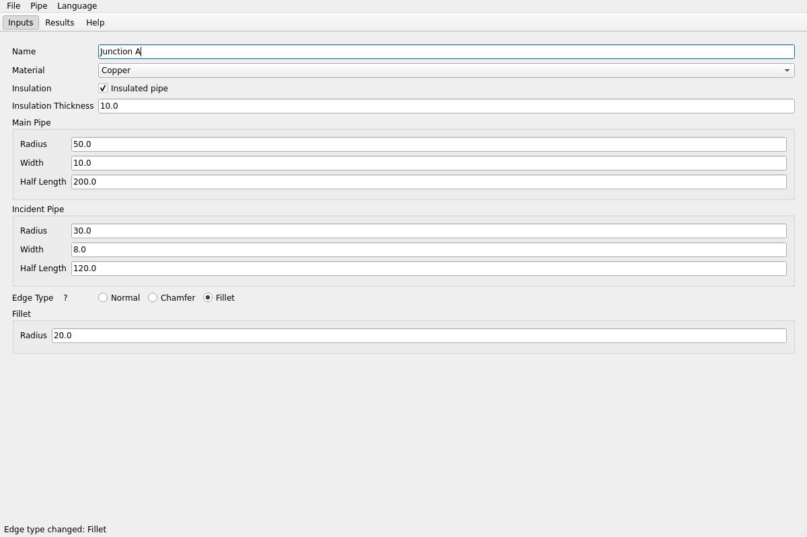

On Textual:

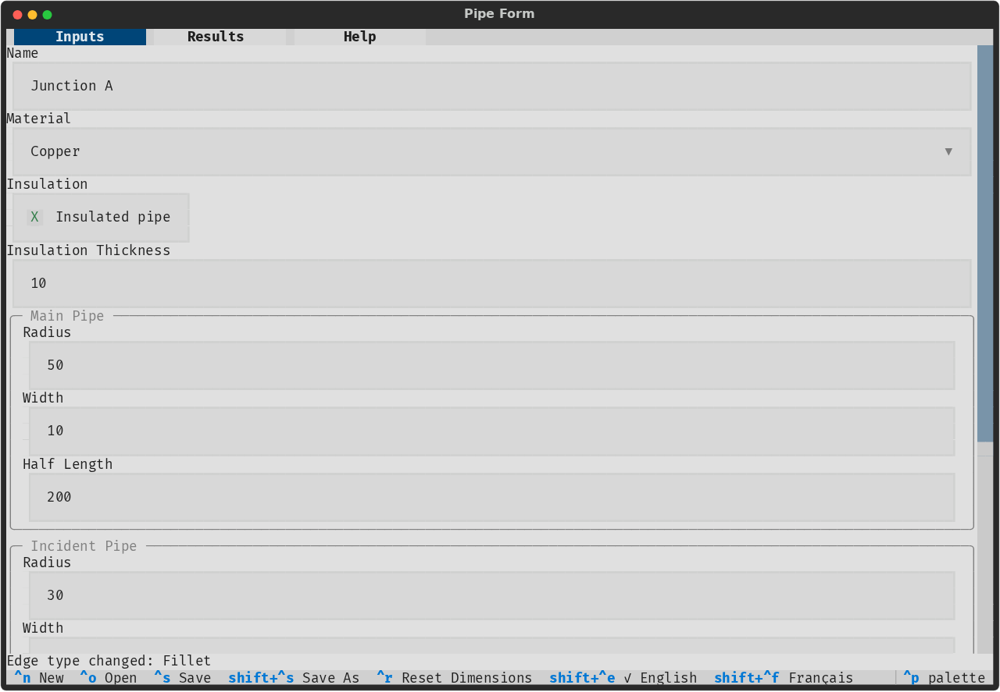

On the web:

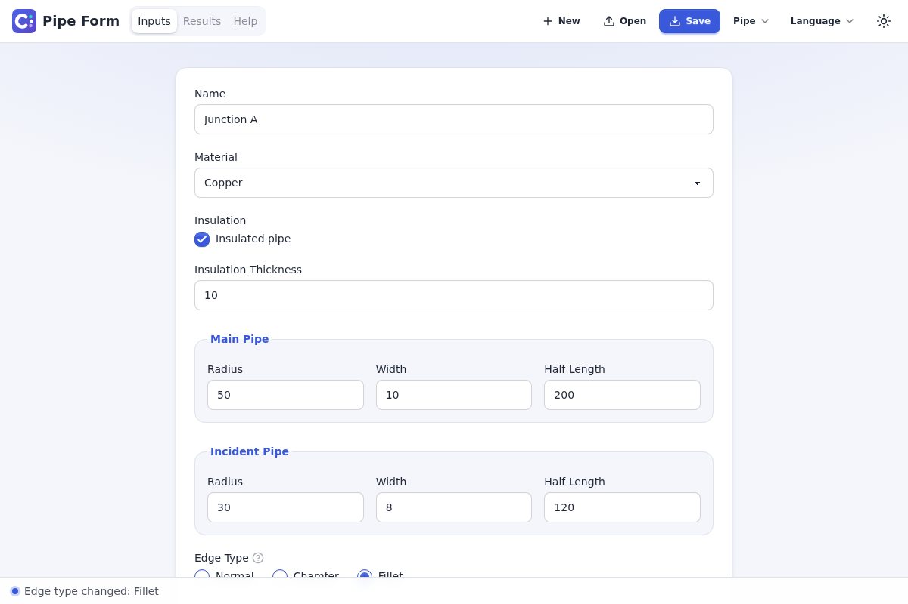

It shows:

- [forms](user-guide/building-views.md#forms-and-their-fields) with labelled rows: text, float
  inputs, a checkbox, radio groups, and a combobox;
- validation on a row, such as the name, and across rows, such as a main pipe that must
  fit the incident pipe;
- three [pages](user-guide/organizing-the-window.md#pages): Inputs, Results (a read-only table of
  the dimensions), and Help (a [Markdown](user-guide/widgets.md#markdown) page);
- a Pipe menu, whose Reset Dimensions asks for a
  [confirmation](user-guide/organizing-the-window.md#dialogs) first;
- the File menu, which saves and loads the study as a `.pipe` file;
- a [French translation](user-guide/translation.md) and a Language menu. To start in
  French, add `--language fr`.

## Markdown viewer

[`markdownviewer.py`](../src/examples/markdownviewer.py) shows a Markdown file.

```bash
uv run python -m examples.markdownviewer --markdown README.md --backend qt
```

On Qt:

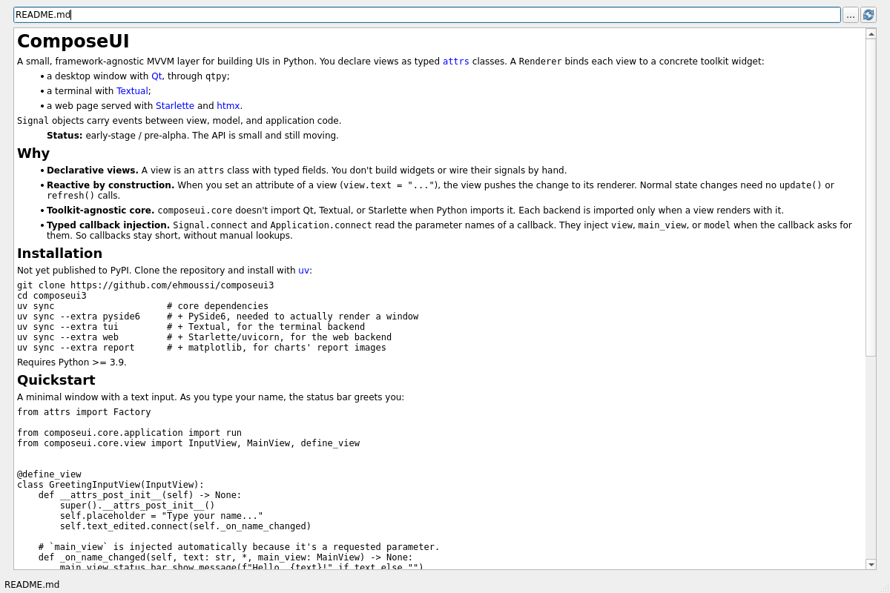

On Textual:

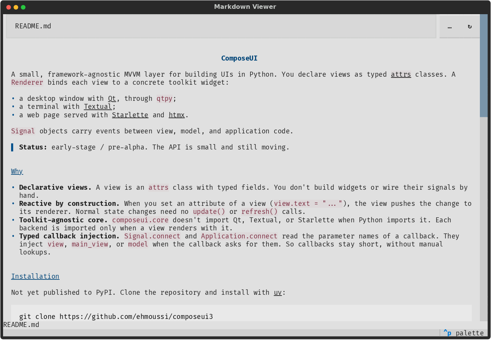

On the web:

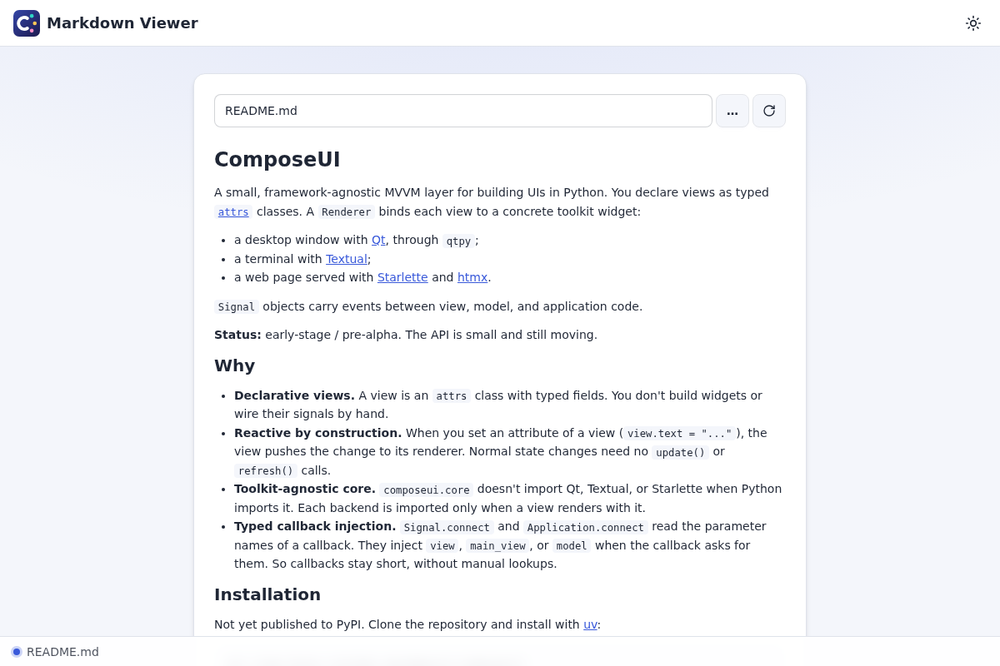

It shows:

- a [Markdown view](user-guide/widgets.md#markdown);
- an [option of the app's own](user-guide/building-views.md#command-line-options-of-your-own):
  `--markdown`, beside the options of the backend;
- a [file path input](user-guide/widgets.md#file-path-input) at the top: the user types the path of
  a file, or picks the file with the "…" button. On the web, the browser uploads it. The
  reload button reads the file again, for example after the user edits it.
- an app without studies: `has_file_menu = False` leaves out the File menu.

## Task view

[`taskview.py`](../src/examples/taskview.py) runs 25 tasks side by side in threads.

```bash
uv run python -m examples.taskview   # web; or --backend qt, or textual
```

On Qt:

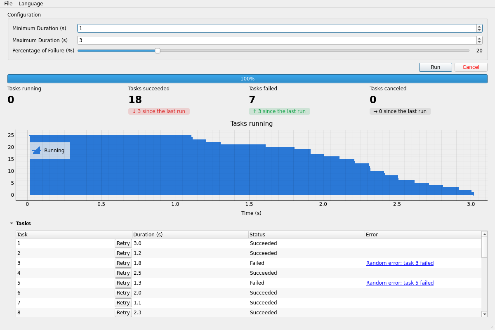

On Textual:

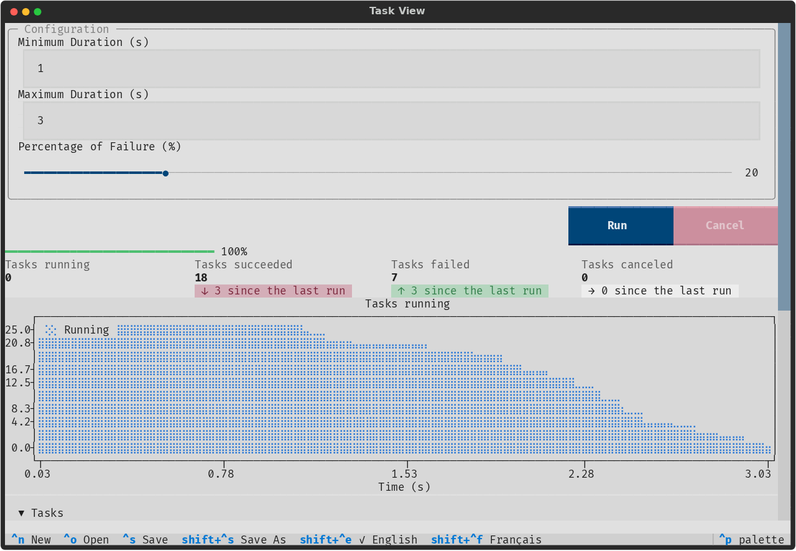

On the web:

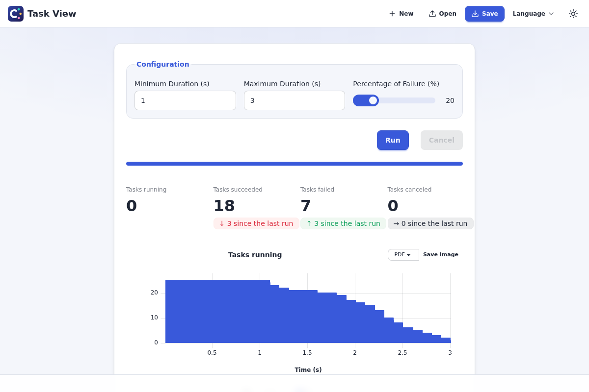

It shows:

- [jobs](user-guide/threads.md): each task is a function that
  runs in a thread and never touches a view. Its job emits the status of the task on the main
  thread, where the views show it. A button cancels the jobs.
- a configuration form with an [integer input](user-guide/widgets.md#integer-input) and a
  [slider](user-guide/widgets.md#slider);
- a [progress bar](user-guide/widgets.md#progress-bar) of the tasks done;
- [metrics](user-guide/widgets.md#metric) that count the tasks. Once a run is over, they show how
  each count changed since the last run.
- a [step chart](user-guide/charts.md#colors-fill-steps-and-height) of the tasks running over the
  time of the run;
- an [expander](user-guide/widgets.md#expander) with the table of the tasks, which collapses to
  leave only the metrics and the chart;
- [widgets in cells](user-guide/tables.md#widgets-in-cells): the Retry button of a task
  runs it again. The error of a failed task is a link that opens a dialog with its details.
- a [French translation](user-guide/translation.md) and a Language menu.

## Pipe chart

[`pipechart.py`](../src/examples/pipechart.py) plots the pressure drop of a pipe against its
flow rate.

```bash
uv run python -m examples.pipechart   # qt; or --backend textual, or web
```

On Qt:

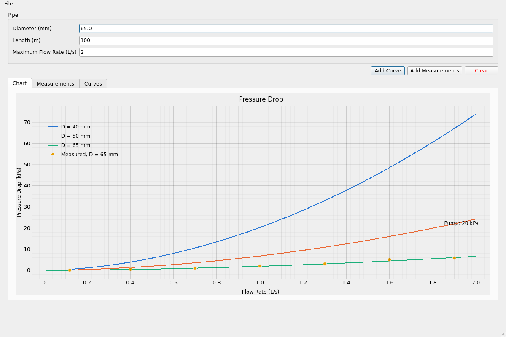

On Textual:

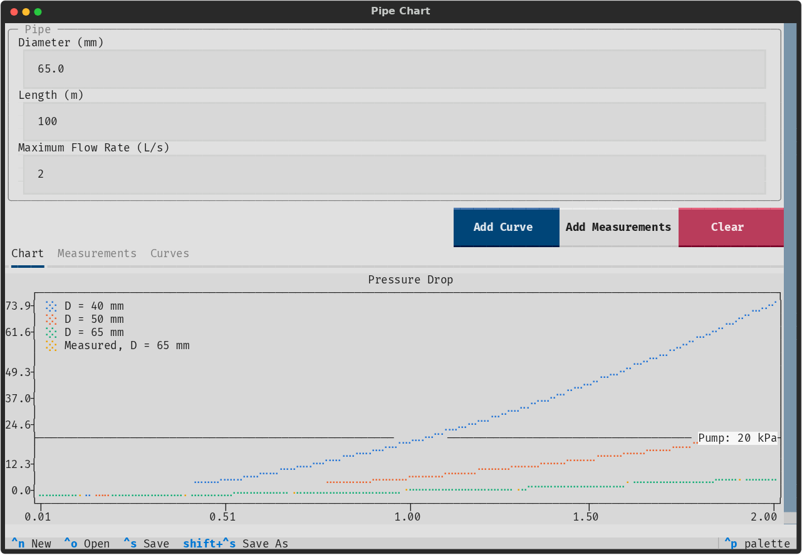

On the web:

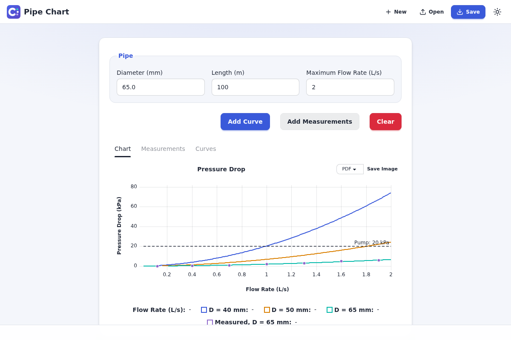

It shows:

- a [line chart](user-guide/charts.md): each click on Add Curve plots one curve for the
  diameter in the form, with its own flow rates;
- a gap in a curve: between laminar and turbulent flow neither law holds, so the curve
  leaves a gap there (a NaN);
- [scatter series](user-guide/charts.md#kinds-of-chart): Add Measurements plots, as dots over the
  curves, what a test rig measured on that pipe;
- a [reference line](user-guide/charts.md#reference-lines) at the pressure of the pump;
- [tabs](user-guide/organizing-the-window.md#tabs): the chart on one tab, and the measurements in a
  [table of records](user-guide/tables.md#a-table-of-records) on the Measurements tab,
  each against the computed drop;
- [how cells and headers look](user-guide/tables.md#how-cells-and-headers-look) on the
  Measurements tab:
  - the pipe's cell spans the rows of its measurements;
  - "Pressure Drop (kPa)" is a header over "Measured" and "Computed";
  - a computed drop that the model can't give (NaN, in transitional flow) is red;
  - a deviation over 10 % is orange, with a warning mark;
  - the Kept check box of a NaN row is disabled: that measurement can't be compared with
    the model;
  - a summary under the table shows the measurements kept, with a header before each row;
- [widgets in cells](user-guide/tables.md#widgets-in-cells): the Curves tab lists every
  curve. A check box shows or hides the curve, and the box in the header shows or hides them all. A
  combobox draws the curve as a line, in steps, or as dots.

## Pipe catalogue

[`pipecatalogue.py`](../src/examples/pipecatalogue.py) is a catalogue of pipes, kept in a
SQLite database.

```bash
uv run python -m examples.pipecatalogue   # web; or --backend qt, or textual
```

On Qt:

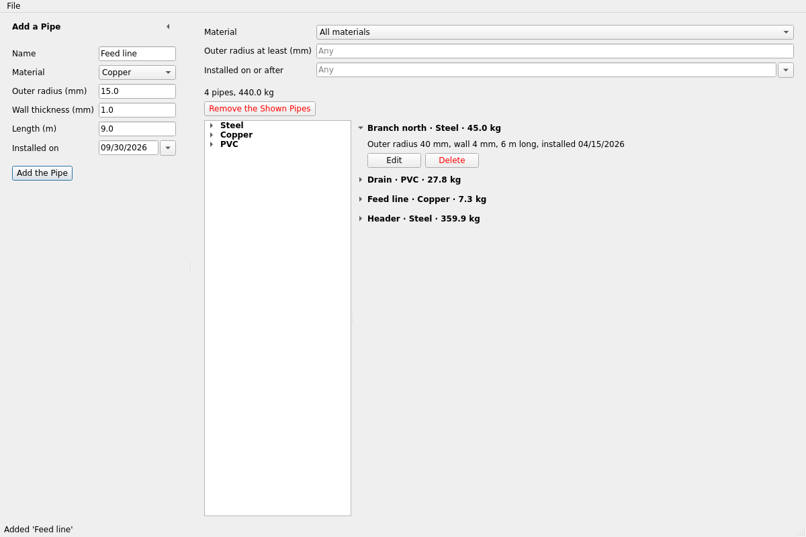

On Textual:

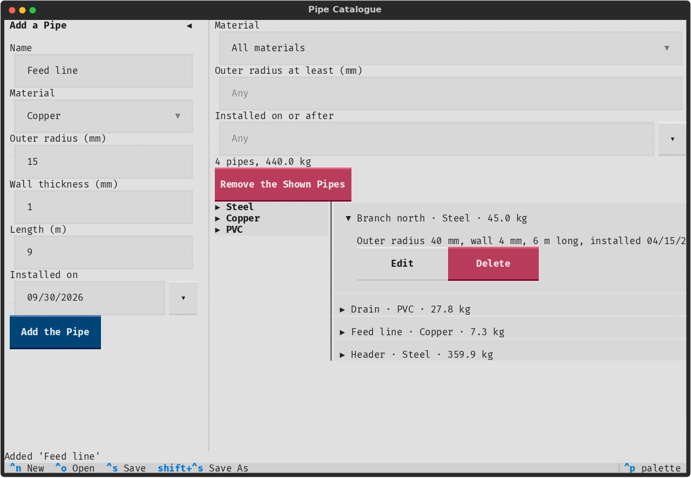

On the web:

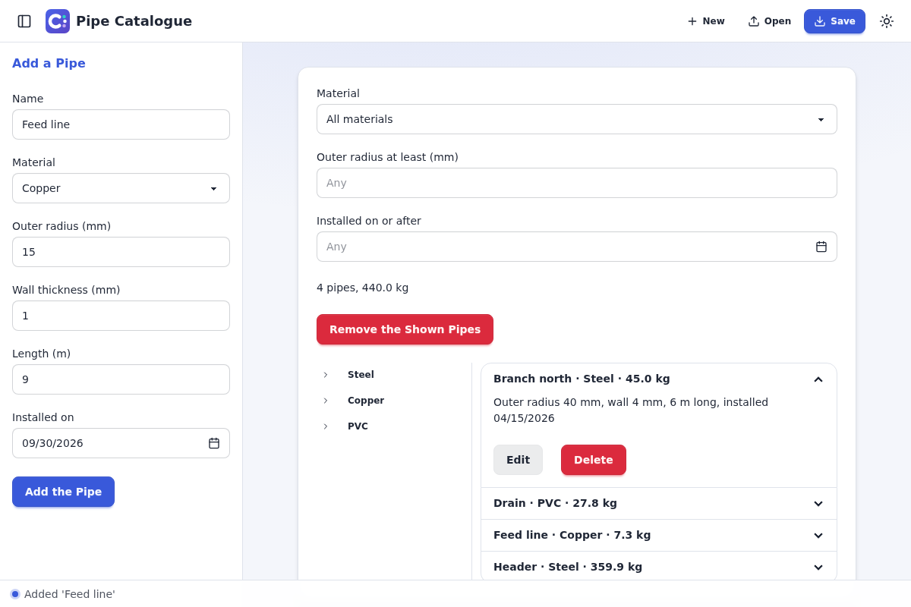

It shows:

- a [SQLite model](user-guide/sqlite-model.md): the pipes are rows of the
  model's database, not view state. The database checks every pipe added or changed: a name,
  positive dimensions, and a wall thinner than the radius. A SQL view computes the mass of each pipe
  from its material.
- a [sidebar](user-guide/organizing-the-window.md#sidebar) with a form that adds a pipe;
- a [list of views](user-guide/organizing-the-window.md#a-list-of-views): an
  [expander](user-guide/widgets.md#expander) per pipe, with its Edit and Delete buttons. A query
  filters the list by material, radius, and installation date.
- a [tree](user-guide/widgets.md#tree) of the pipes by material, beside the list, in
  [resizable panes](user-guide/organizing-the-window.md#resizable-panes). The materials are bold. A
  pipe has a done mark when its installation date is known, and a warning mark until then. When the
  user selects a pipe in the tree, its expander expands.
- a [form dialog](user-guide/organizing-the-window.md#form-dialogs) that edits a pipe;
- a [date input](user-guide/widgets.md#date-input) for the installation date of a pipe;
- studies saved as a `.pipes` file with the views and the database. A study saved before
  pipes had an installation date gets the column, empty, when it opens, through a
  migration (`PipeCatalogueModel.migrations`).

## Pipe sweep

[`pipesweep.py`](../src/examples/pipesweep.py) sweeps the outer radius of a pipe under
pressure, and finds the hoop stress in its wall at each radius.

```bash
uv run python -m examples.pipesweep   # web; or --backend qt, or textual
```

On Qt:

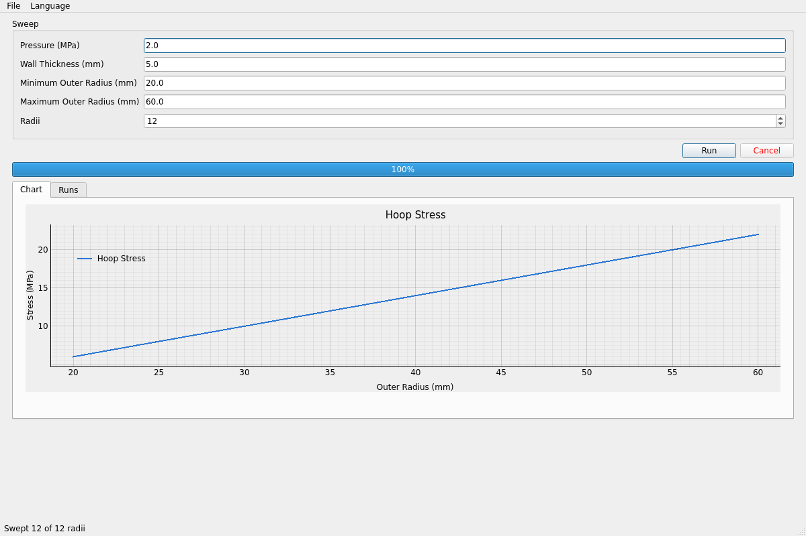

On Textual:

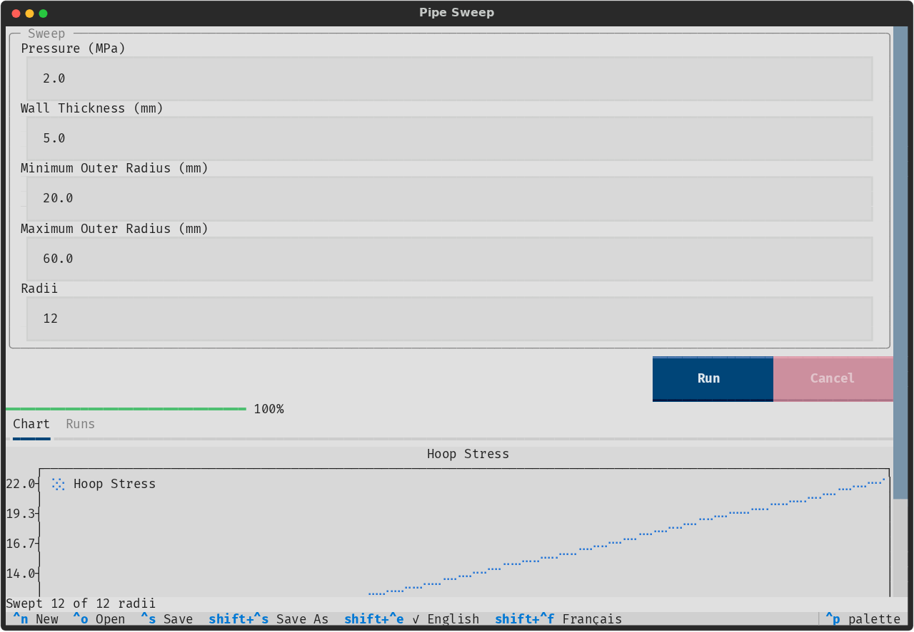

On the web:

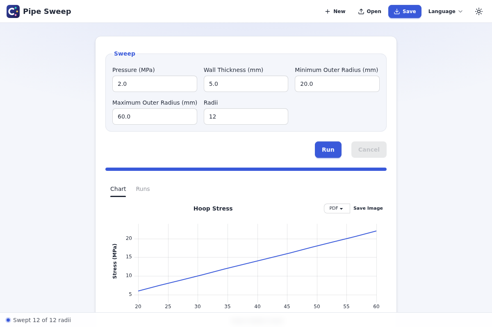

It shows:

- a [job](user-guide/threads.md) that works in a thread, one
  radius at a time, and [writes each run](user-guide/sqlite-model.md) to the
  model's database when the run is done. The job never touches a view. The `changed` signal of each
  write is emitted on the main thread, where the views show the runs written so far. Cancel stops
  the sweep after the current run.
- a form that checks the sweep before it starts, such as a wall thinner than the minimum
  radius;
- a [progress bar](user-guide/widgets.md#progress-bar) of the runs written, and two
  [tabs](user-guide/organizing-the-window.md#tabs): a [line chart](user-guide/charts.md) of the
  runs, and a table of them;
- the File menu, which saves and opens the runs with the views as a `.sweep` file;
- a [French translation](user-guide/translation.md) and a Language menu. To start in
  French, add `--language fr`.

## Large table

[`largetable.py`](../src/examples/largetable.py) shows a million made-up sensor readings,
kept in SQLite, in a large table.

```bash
uv run python -m examples.largetable   # qt; or --backend web, or textual
uv run python -m examples.largetable --rows 100000   # fewer readings, a faster start
```

On Qt:

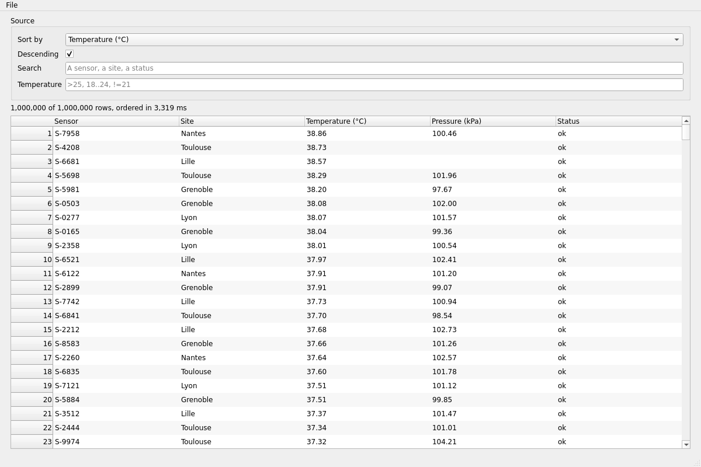

On Textual:

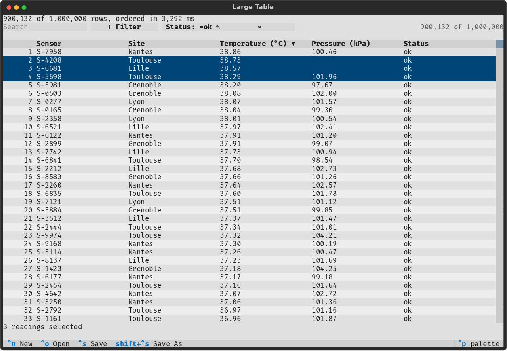

On the web:

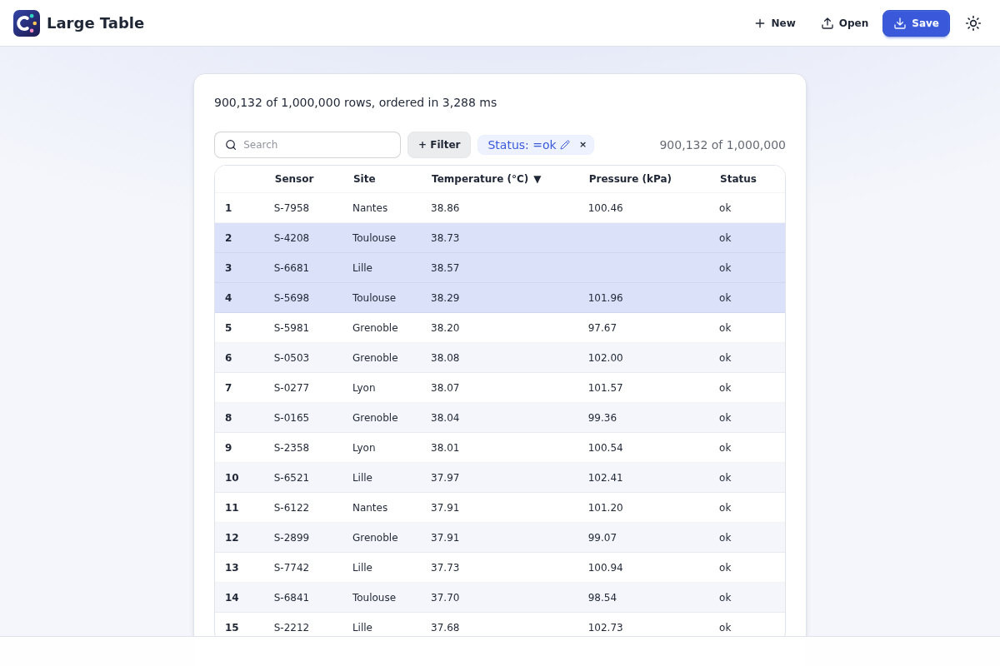

It shows:

- a [large table](user-guide/tables.md#a-large-table): a `SourceTableView` on a
  [`SqliteSource`](user-guide/tables.md#rows-in-sqlite) of the readings. SQLite sorts and
  filters them, indexed by the columns that sort; each backend draws the rows on screen alone, and
  reads them as the user scrolls. Python keeps the shown rows' ids, never the readings.
- a [job](user-guide/threads.md) writing the readings into the
  [SQLite model](user-guide/sqlite-model.md), a batch at a time: the window
  shows at once, and the table fills once they are written.
- a sort by a click on a header, and the table's
  [filter bar](user-guide/tables.md#sorting-and-filtering): a search in the text columns,
  and a filter on any column. On Qt and Textual, a job orders the rows, the window staying
  responsive. The label says how many rows pass and how long SQLite took to order them, once the
  table's `ordered` emits.
- a selection of several rows: the label under the table counts them, and shows the
  reading that a double click or Enter activates (on Qt and Textual). Ctrl+C copies them,
  to paste in a spreadsheet.
- an export of the rows shown to a CSV file: a job writes it on Qt and Textual, and the
  status bar says when it's done; the web downloads it.
- an [option of the app's own](user-guide/building-views.md#command-line-options-of-your-own):
  `--rows`, the readings to make up (1,000,000 by default).
- a study that saves the readings with the model, and the table's settings with the views.
  Opened with `-f`, it shows its own readings: none are made up.

## Uber pickups

[`uberpickups.py`](../src/examples/uberpickups.py) explores the Uber pickups of September 2014
in New York City, after Streamlit's tutorial.

```bash
uv run python -m examples.uberpickups   # web; or --backend qt, or textual
```

These screenshots use made-up rows. The street map needs a network connection for its
tiles. Textual shows no map.

On Qt:

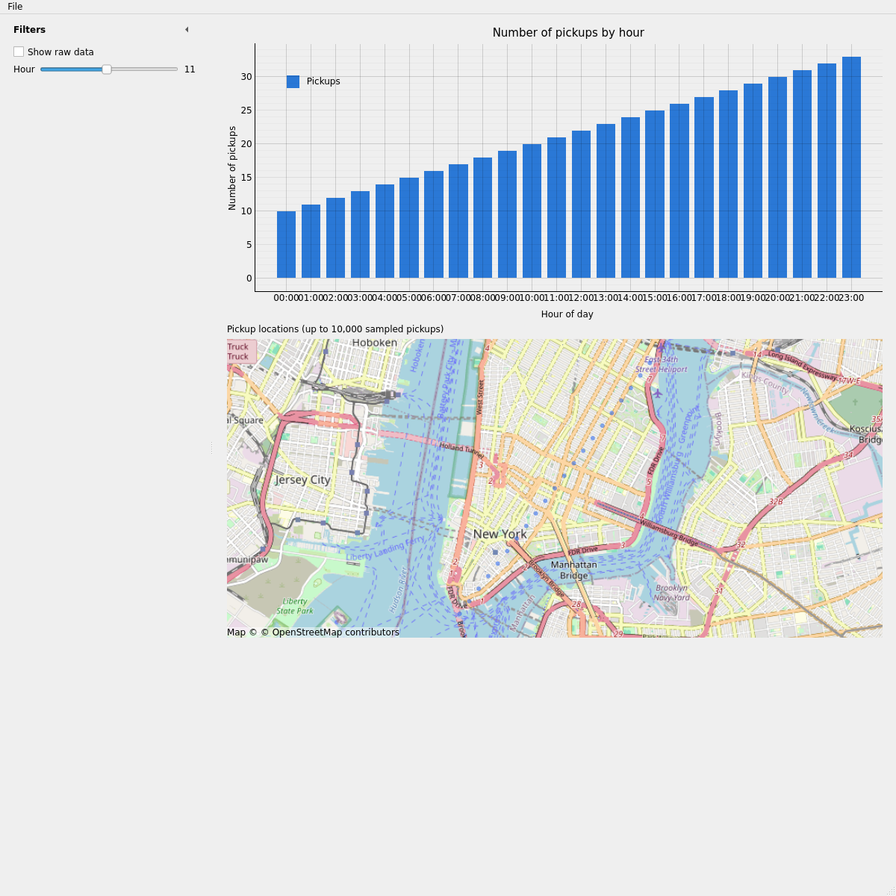

On Textual:

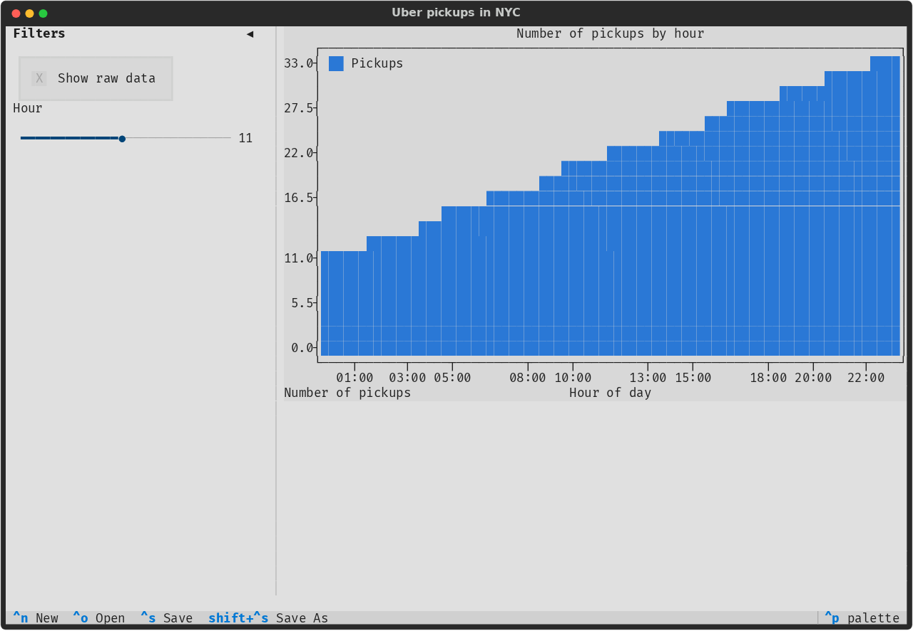

On the web:

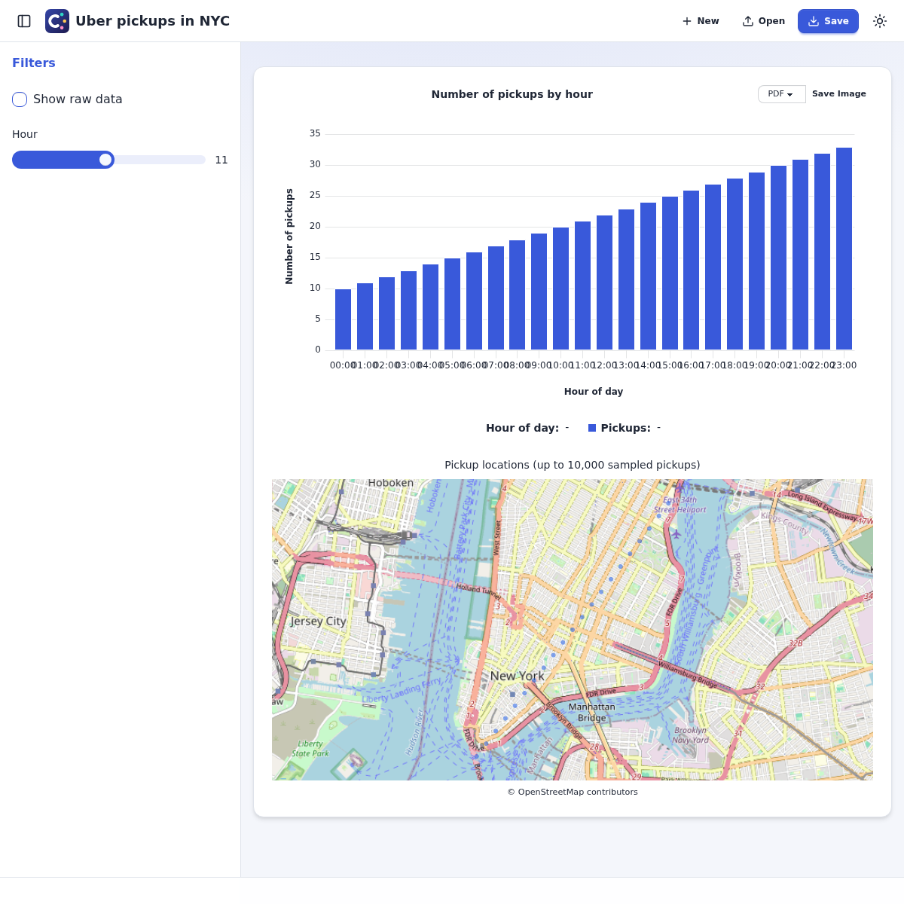

It shows:

- a [CSV URL](user-guide/csv-import.md#csv-urls) imported into a typed SQLite table. The
  app downloads the CSV file when it first starts. A saved study keeps the rows, so the
  app does not download them again when the study opens.
- a [loading task](user-guide/threads.md#reusable-loading-tasks) that imports the rows in a
  job. `Task.show_state` shows its state in a status line: the count of rows read, or the
  error. It shows the chart and the map once the task has a result. The task's `finished`
  callback gives them their data.
- a [bar chart](user-guide/charts.md#kinds-of-chart) of the pickups per hour, which counts
  all the rows. `bar_chart`, from `composeui.core.dashboard`, sets its kind and its hours.
- a [sidebar](user-guide/organizing-the-window.md#sidebar) of filters: a check box, and a
  [slider](user-guide/widgets.md#slider) of the hour, 11 at the start. The slider is a
  [form row](user-guide/building-views.md#forms-and-their-fields) with its label, straight
  in the sidebar, without a form around it.
- a [map](user-guide/maps.md) of the pickups of the slider's hour, on Qt and the web. The
  map shows at most 10,000 of them, sampled in the order of the rows. A move of the slider
  queries the saved rows again for the map only. The map fits the pickups, and keeps the
  viewport once the user pans or zooms.
- a `DashboardView`: a [wide main view](user-guide/organizing-the-window.md#page-width)
  without pages. This one keeps the File menu, so that a study saves the rows.
- the raw data in a [large table](user-guide/tables.md#a-large-table), with the rows of all
  the hours. `CheckBoxMixin.shows` shows it only while the sidebar's check box is checked.

## Uber pickups on a dataframe

[`uberpickupsframe.py`](../src/examples/uberpickupsframe.py) is the
[Uber pickups](#uber-pickups) app, with its rows in a Polars frame instead of SQLite.

```bash
uv run python -m examples.uberpickupsframe   # web; or --backend qt, or textual
```

It needs the `dataframe` extra and Polars. It reads the CSV file in a job each time that it
starts. It has no File menu, because a study would keep no rows. The table shows the CSV's
own columns. Polars counts the pickups by hour, and samples the pickups of the slider's hour
for the map.

These screenshots use made-up rows. The street map needs a network connection for its
tiles. Textual shows no map.

On Qt:

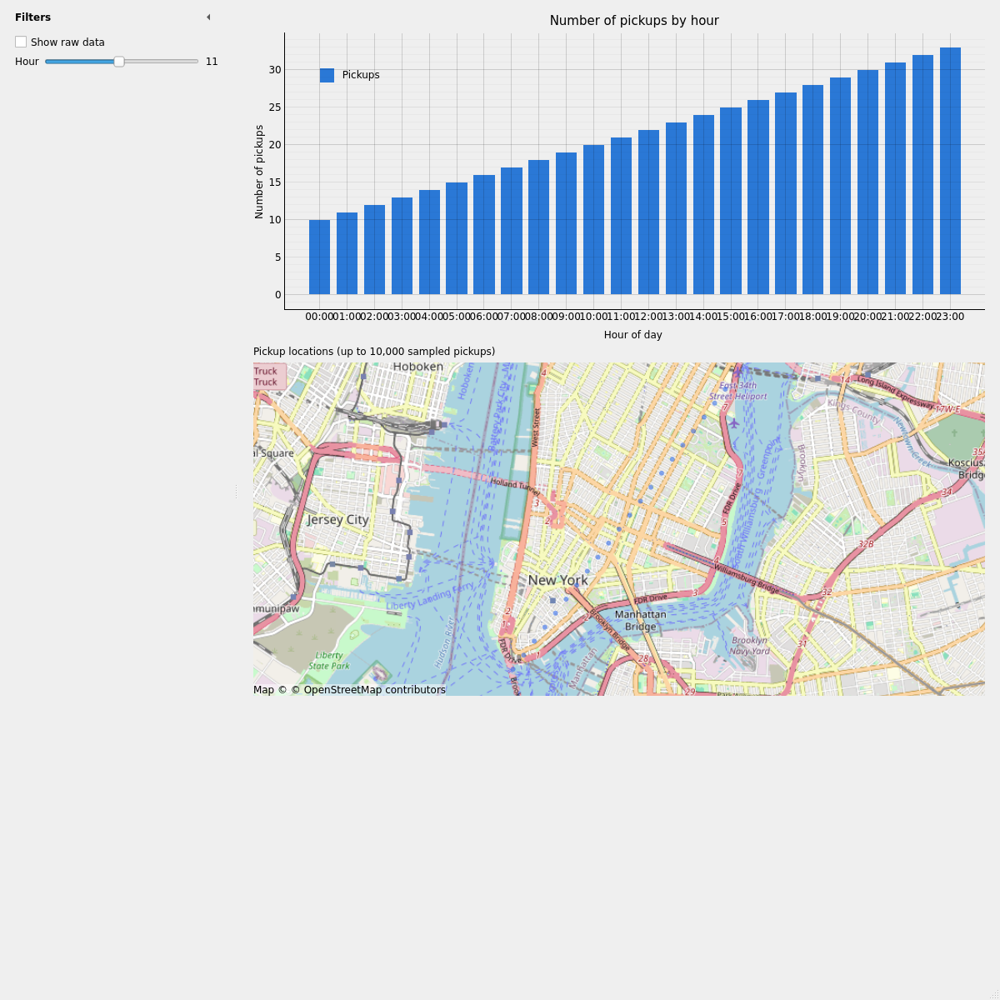

On Textual:

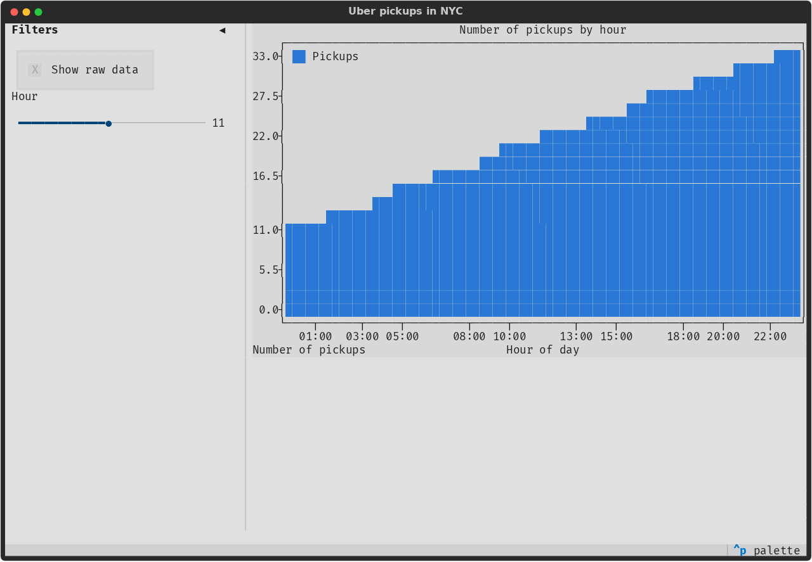

On the web:

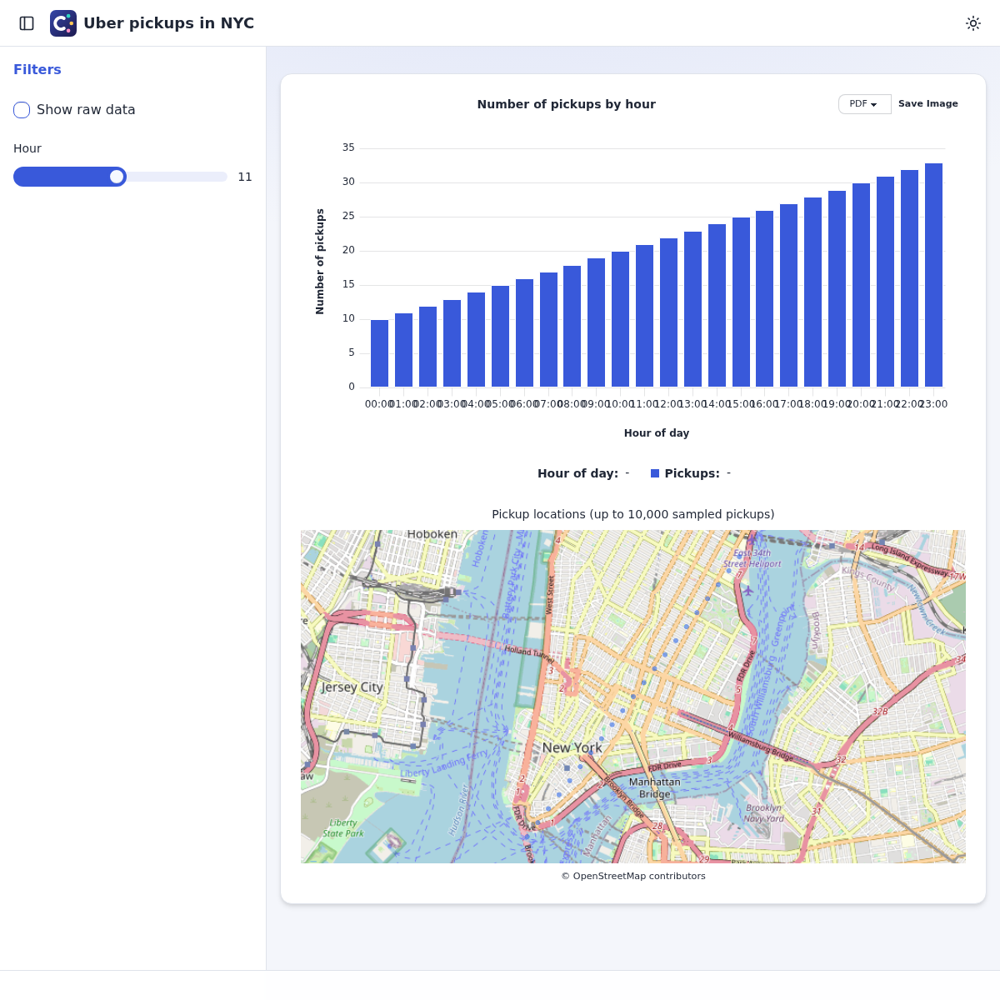

It shows:

- a [large table](user-guide/tables.md#a-large-table) on a
  [`DataFrameSource`](user-guide/tables.md#rows-in-a-dataframe): Polars sorts, searches,
  and filters a million pickups;
- a [job](user-guide/threads.md) that only reads the CSV file. Its result, a frame, becomes
  the table's source on the main thread.
- the status line, the chart, the map, and the sidebar of [Uber pickups](#uber-pickups).
  The chart's series comes from [`Series.bars`](user-guide/charts.md#kinds-of-chart), and
  the map's points from the frame, with
  [`points_of`](user-guide/maps.md#coordinates-points-and-viewport).

## Batman

[`batman.py`](../src/examples/batman.py) draws the Batman logo on a chart.

```bash
uv run python -m examples.batman   # qt; or --backend web, or textual
```

On Qt:

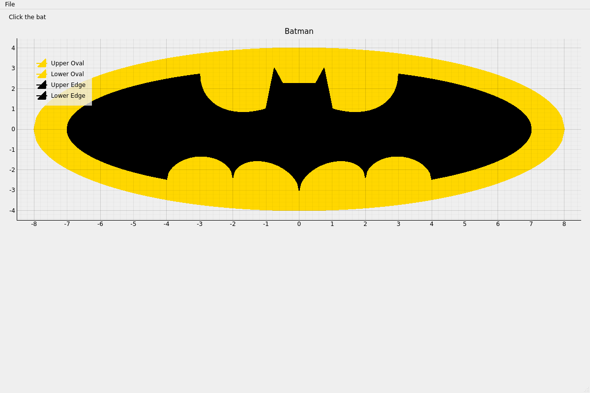

On Textual:

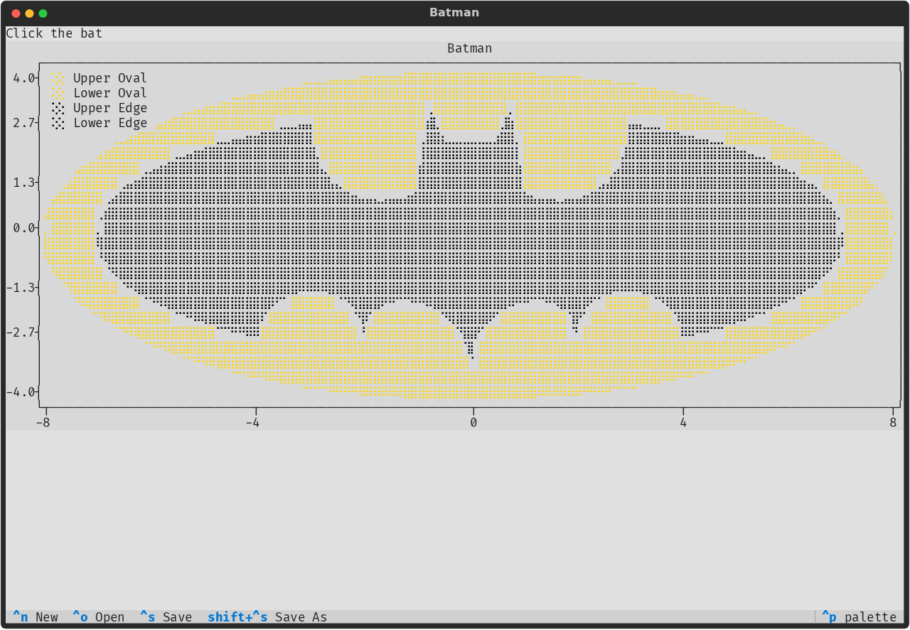

On the web:

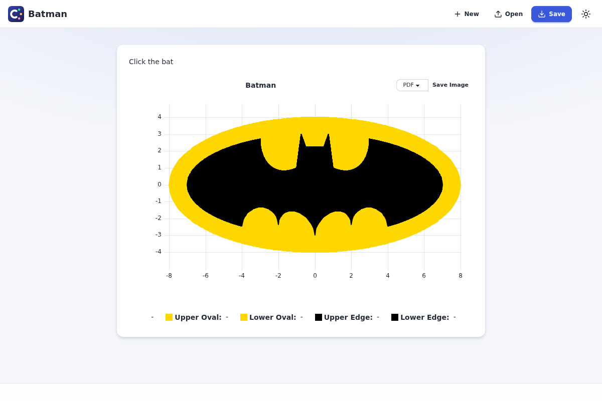

It shows:

- [series colors and fills](user-guide/charts.md#colors-fill-steps-and-height): a yellow oval and
  the edges of the bat in black, each series in the color of the logo, whatever the theme;
- [clicks on a chart](user-guide/charts.md#clicks-on-a-chart): `clicked` emits the point, and the
  view says whether it is on the bat. Textual draws the logo too, but a terminal has no
  pointer to click it with.

## Web hello

[`webhello.py`](../src/examples/webhello.py) is a small form on the
[web backend](user-guide/running-the-app.md#web-backend) only.

```bash
uv run python -m examples.webhello
```

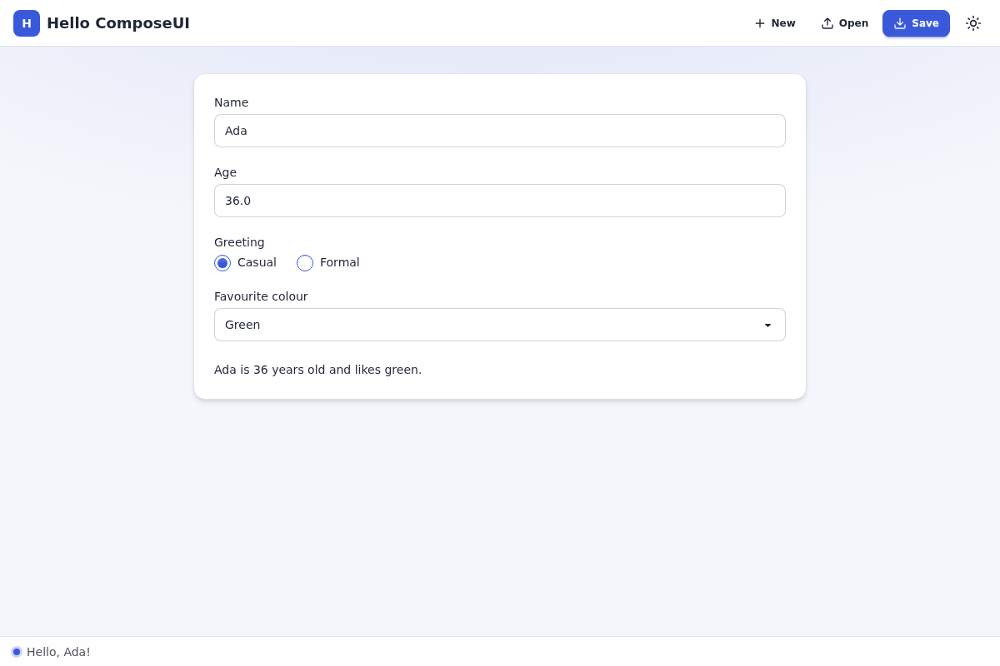

It serves http://127.0.0.1:8000. It shows:

- an application built as a `WebApplication` subclass, without `run`;
- a form with a text input, a float input, a radio group, and a combobox, with validation
  on the name and the age;
- one keystroke that updates the status bar, the log of the row, and a summary label at
  once.

## Textual demo

[`textual_demo.py`](../src/examples/textual_demo.py) is a small form in a terminal.

```bash
uv run python -m examples.textual_demo
```

On Qt:

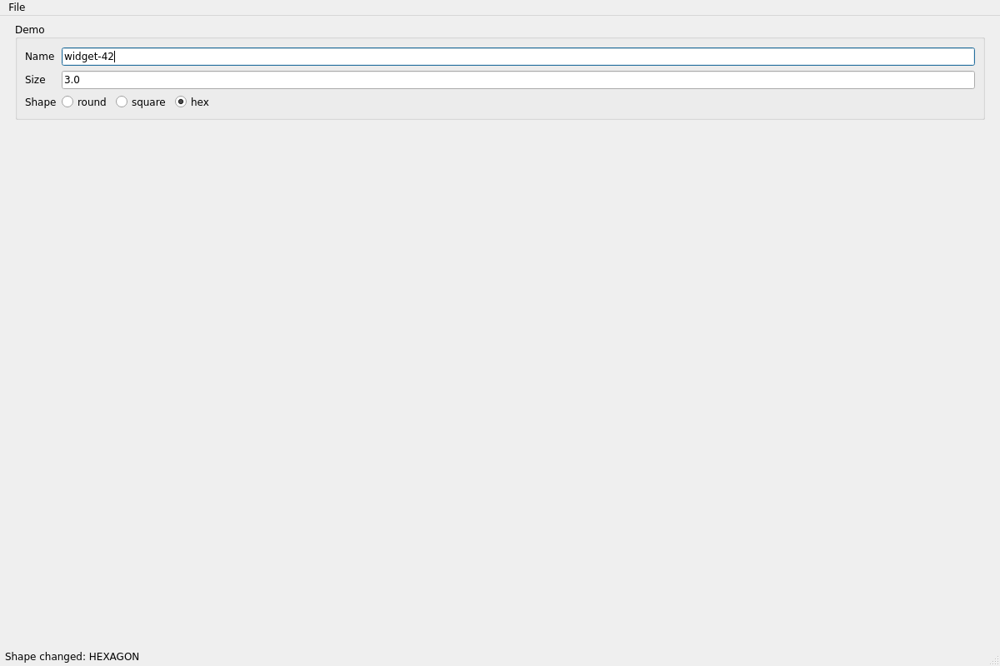

On Textual:

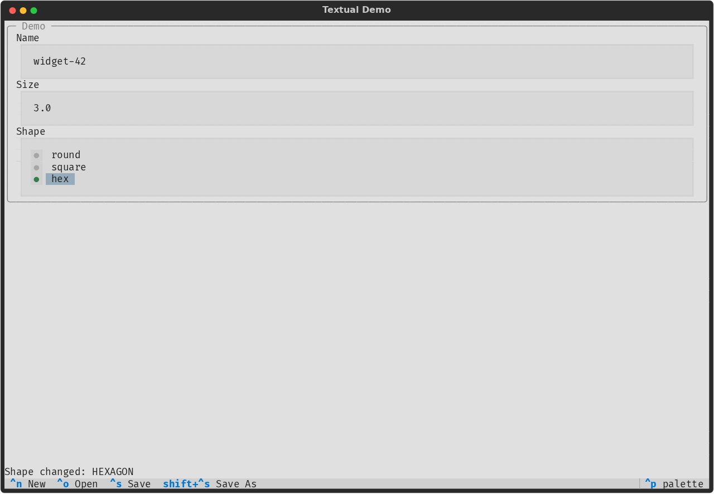

On the web:

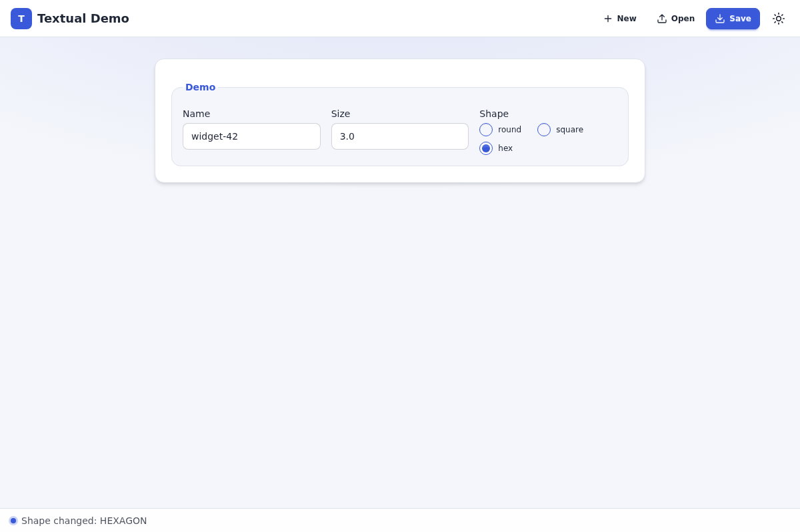

It shows a form with a text input, a float input, and a radio group. A change of shape
shows a message in the status bar. It starts on Textual: `run(...,
default_backend=RendererType.TEXTUAL)`.
