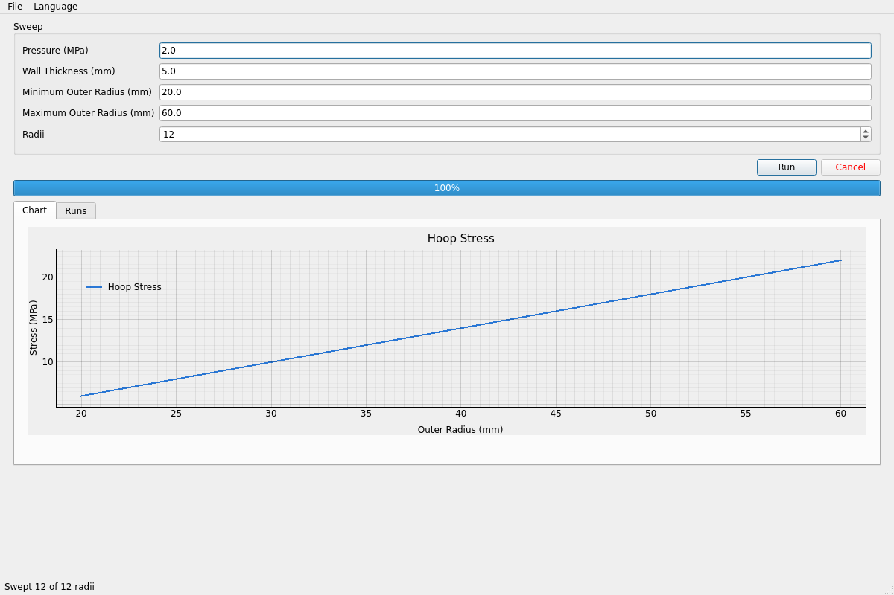
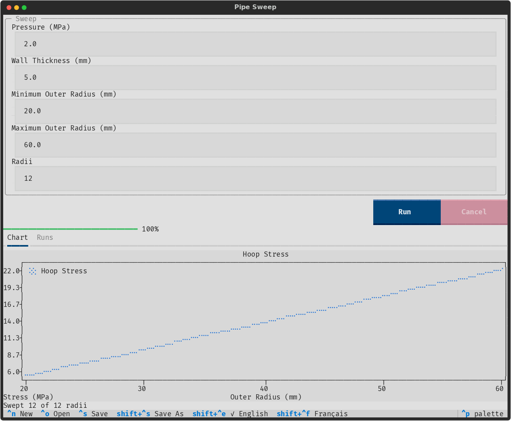
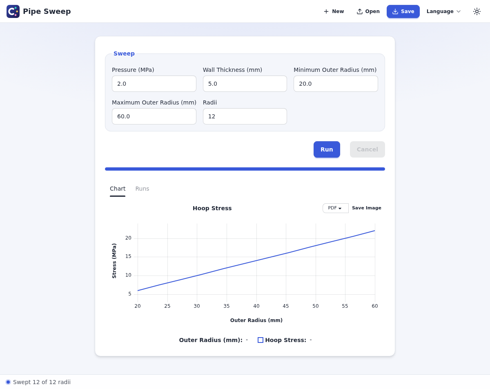
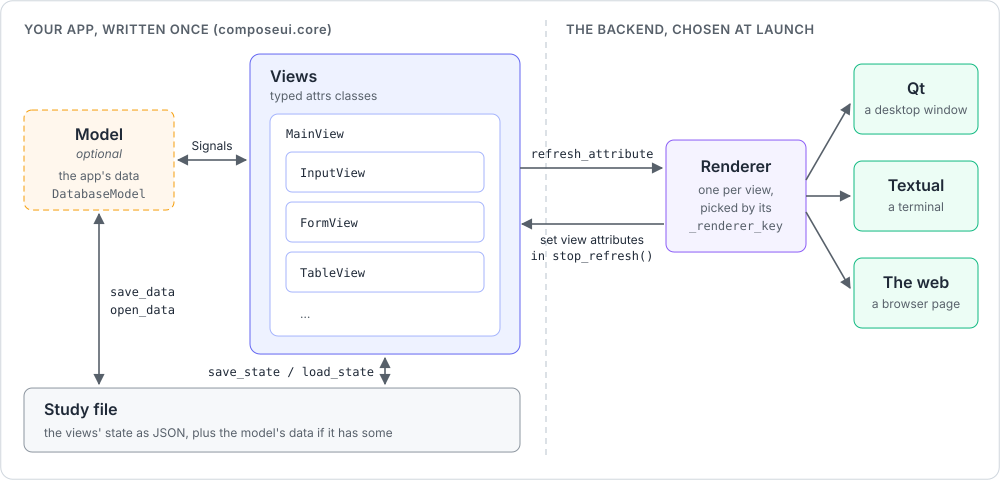

# ComposeUI: Turn your Python work into an app

ComposeUI turns a Python script into an app that other people can use. It is for the data
scientists and simulation engineers who know Python, and want to put a form, a chart, or a
"Run" button around their work.

**No GUI toolkit, HTML, or JavaScript to learn. Just Python.**

You describe the screen in plain Python classes: the inputs, the tables, the charts. ComposeUI
draws it, and the same code runs in three places:

- **A desktop window**, for an app on your own computer (Qt).
- **A terminal**, for example on a remote computer or a cluster, over SSH (Textual).
- **A web page** that your team opens in a browser (the web backend).

> **Status:** early-stage / pre-alpha. The API can still change in any release.

## What you can build

- **The input form of a simulation.** Fields, choices, and checks that tell the user what is
  wrong before the run starts. See [Building views](user-guide/building-views.md).
- **A front end for a solver.** Run a long computation or an external program in the
  background, with a progress bar, its output, and a "Cancel" button. See
  [Running work in threads](user-guide/threads.md).
- **A dashboard from a dataframe.** Filters, metrics, charts, a map, and a table of a pandas or
  Polars frame, with a download of the rows shown. See
  [Dashboards from a dataframe](user-guide/dashboards.md).
- **Results that you can explore.** Line and scatter charts, Matplotlib figures, and tables of
  a million rows that the user sorts and filters. See [Charts](user-guide/charts.md) and
  [Tables](user-guide/tables.md).
- **Studies that you save and open again.** The File menu saves all the inputs of the app in
  one file, so a user can come back to a study, or send it to a colleague.

## One app, three backends

The [pipe sweep](examples-guide.md#pipe-sweep) example is one set of views. Its `--backend`
option picks where it shows:

| A desktop window (Qt) | A terminal (Textual) | A web page |
| --- | --- | --- |
|  |  |  |

## Start here

1. Install ComposeUI with the extras of the backends that you want, for example the web and
   Qt backends:

   ```bash
   pip install "composeui[web,pyside6]"
   ```

   [Installation](../README.md#installation) in the README lists every extra.
2. Write a first app with the [Quickstart](../README.md#quickstart) of the README.
3. Read the [core concepts](user-guide/core-concepts.md) of the user guide: views,
   signals, the model, and studies.
4. Run the [example apps](examples-guide.md#run-an-example), and read their code.
5. To build with a coding agent, install the ComposeUI skill: see
   [Using a coding agent](user-guide/coding-agents.md).

## How it works

For software developers, ComposeUI is an MVVM layer. The views are typed `attrs`
classes: in MVVM terms, they are the view-models. A renderer binds each view to a widget of
the backend, and signals carry the events between the views, the model, and the app.



- **The views describe the UI.** The app is a tree of views under a `MainView`.
  `composeui.core` holds them, and imports no backend.
- **The model is optional.** It holds the app's data beside the views, for example in
  SQLite with `DatabaseModel`. Give it to `run` with `build_model=`. A small app needs only
  views.
- **Signals connect the views and the model.** A callback asks for `view`, `main_view`, or
  `model` by parameter name, and the signal gives them.
- **A study file saves the app.** `MainView.save_state` writes the views' state as JSON,
  with `cattrs`, and `load_state` reads it back. A model with data of its own adds its file
  (`save_data`, `open_data`), and the study becomes an archive of both. See
  [Saving and loading state](user-guide/building-views.md#saving-and-loading-state).
- **A renderer binds each view to a widget.** The backend that you choose at launch gives
  the renderer, by the view's `_renderer_key`.
- **The renderer syncs both directions.** When code sets a view attribute, the renderer
  shows it (`refresh_attribute`). When the user edits the widget, the renderer writes the
  value back into the view, from the widget's signal.

The [architecture](technical-guide/architecture.md) page explains how the parts fit together.

## Find your way

To build an app:

- The [user guide](user-guide.md) explains how to build an app. It covers the views, their
  layout, forms and their checks, reactive methods, and the widgets. It also covers pages, tabs,
  dialogs, tables, charts, maps, threads, SQLite models, CSV imports, and translations. It ends
  with what each backend shows, how to test an app, and how to use a coding agent.
- The [examples guide](examples-guide.md) says what each example app shows, and how to run
  it.
- The [widget catalog](widgets.md) lists every view that a backend renders.
- The [API reference](api/index.md) documents each module of `composeui.core`, and the
  application classes of the backends.

To work on ComposeUI:

- The [GitHub repository](https://github.com/ehmoussi/composeui) holds the source code and issue
  tracker.
- The [technical guide](technical-guide.md) explains how ComposeUI works, how to add a widget
  or a backend, and how to run the tests and checks.
- The [roadmap](../ROADMAP.md) lists the work that is left.

```{toctree}
:hidden:

user-guide
examples-guide
widgets
api/index
technical-guide
```
