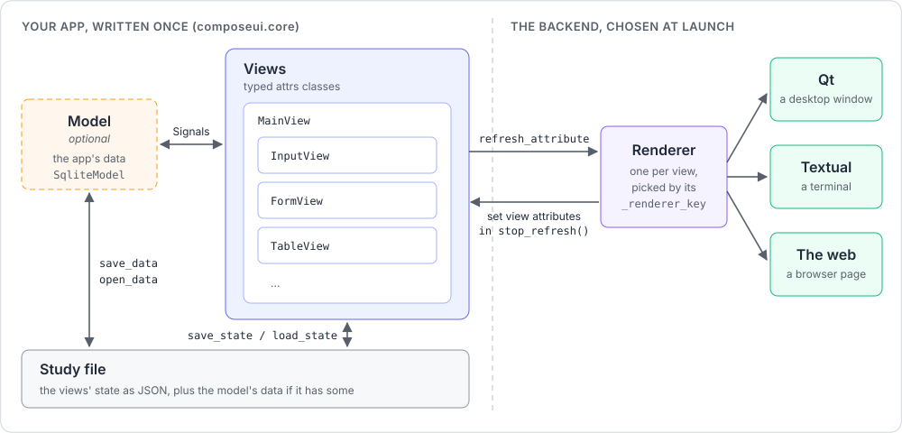

# ComposeUI

ComposeUI is a small MVVM layer for building UIs in Python. You write the views once, as
typed `attrs` classes. A renderer binds each view to a widget of a backend:

- **Qt** shows a desktop window, through `qtpy`.
- **Textual** shows the app in a terminal.
- **The web** serves the app as a page, with Starlette and htmx.

Signals carry the events between the views, the model, and the app.

> **Status:** early-stage / pre-alpha. The API is small and still moving.

## How it works



- **The views describe the UI.** The app is a tree of views under a `MainView`.
  `composeui.core` holds them, and imports no backend.
- **The model is optional.** It holds the app's data beside the views, for example in
  SQLite with `SqliteModel`. Give it to `run` with `build_model=`. A small app needs only
  views.
- **Signals connect the views and the model.** A callback asks for `view`, `main_view`, or
  `model` by parameter name, and the signal gives them.
- **A study file saves the app.** `MainView.save_state` writes the views' state as JSON,
  with `cattrs`, and `load_state` reads it back. A model with data of its own adds its file
  (`save_data`, `open_data`), and the study becomes an archive of both. See
  [Saving and loading state](user-guide.md#saving-and-loading-state).
- **A renderer binds each view to a widget.** The backend that you choose at launch gives
  the renderer, by the view's `_renderer_key`.
- **The renderer syncs both directions.** When code sets a view attribute, the renderer
  shows it (`refresh_attribute`). When the user edits the widget, the renderer writes the
  value back into the view (`update_state`).

The [technical guide](technical-guide.md#architecture) explains the architecture in detail.

## One app, three backends

The [pipe form](examples-guide.md#pipe-form) example is one set of views. Its
`--backend` option picks the backend that shows it.

On Qt:


On Textual:


On the web:


## Start here

1. Install ComposeUI and the extras of the backends that you want
   (see [Installation](../README.md#installation) in the README).
2. Write a first app with the [Quickstart](../README.md#quickstart) of the README.
3. Read the [core concepts](user-guide.md#core-concepts) of the user guide: views,
   signals, the model, and the app.
4. Run the [example apps](examples-guide.md#run-an-example), and read their code.

## Find your way

To build an app:

- The [user guide](user-guide.md) explains how to build an app: the views, their layout,
  forms and their checks, the widgets, pages, tabs, dialogs, tables, charts, threads, SQLite
  models, translations, and what each backend shows.
- The [examples guide](examples-guide.md) says what each example app shows, and how to run
  it.
- The [widget catalog](widgets.md) lists every view that a backend renders.
- The [API reference](api/index.md) documents each module of `composeui.core`, and the
  application classes of the backends.

To work on ComposeUI:

- The [technical guide](technical-guide.md) explains how ComposeUI works inside: its
  [architecture](technical-guide.md#architecture), how to add a widget or a backend, the
  tests, and the checks.
- The [roadmap](../ROADMAP.md) lists the work that is left.

```{toctree}
:hidden:

user-guide
examples-guide
widgets
api/index
technical-guide
```
