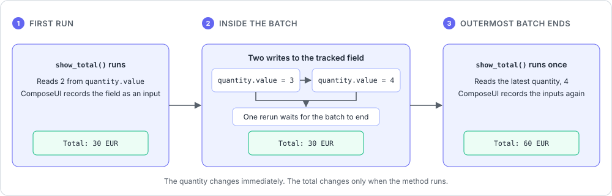
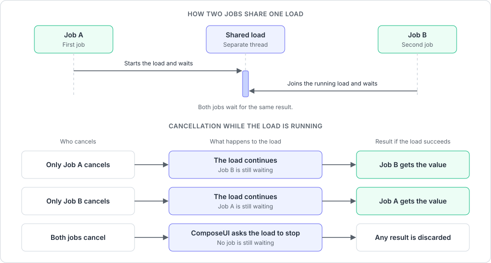
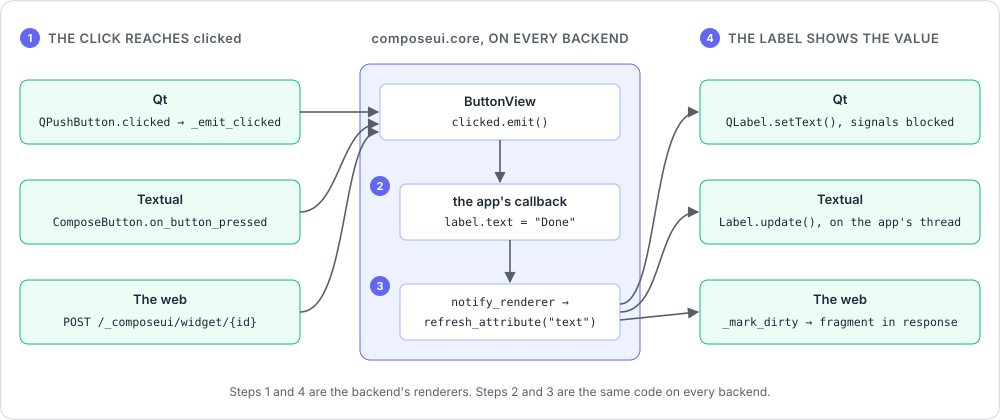

# Architecture

This page explains how the core and the backends work together to render views and handle events.

## Project layout

```
src/composeui/
  cli.py         # the `composeui` command (`composeui run app.py`, `composeui translations`)
  core/          # toolkit-agnostic: views, signals, renderer base, application, registry
    _views/      # the views, a module per family (view.py exports them)
  qtcore/        # Qt backend via qtpy (QtApplication, qtrenderer.py, custom widgets/)
    _renderers/  # its renderers, a module per family (renderers.py maps their keys)
  textualcore/   # Textual (TUI) backend
    _renderers/  # its renderers, a module per family (renderers.py maps their keys)
  webcore/       # Web backend (Starlette + htmx + daisyUI); static/app.css is built
    _renderers/  # its renderers, a module per family (renderers.py maps their keys)
css/             # source of webcore/static/app.css (`make css`; tools land in css/vendor/)
js/              # the scripts' type check (`make js-check`; TypeScript lands in js/vendor/)
specs/           # TLA+ specs, checked by TLC (`make specs`; TLC lands in specs/vendor/)
src/examples/    # example apps (pipeform.py, pipecatalogue.py, ...), also used by tests; not in the wheel
tests/           # pytest suite (pytest-qt, pytest-asyncio, Textual run_test pilot)
  qtcore/        # the Qt backend's tests, a module per family, as in _renderers/
  textualcore/   # the Textual backend's tests, a module per family, as in _renderers/
  webcore/       # the web backend's tests, a module per family or per other webcore module
  contracts/     # the rules every backend follows, each test run on each backend
docs/            # the user guide (user-guide/), the examples guide, this guide, the Sphinx site
```

## The core imports no backend

Importing `composeui.core` does not load Qt, Textual, or the web backend. When an app calls
`run`, it imports the application module for the selected backend before starting the app.
When a view needs a renderer, the registry imports the renderers module for that backend.
`tests/test_renderer_registry.py` checks that importing `composeui.core.view` loads no toolkit.

## The registry

`composeui.core.registry` maps renderer keys to the renderers of each backend:

- Each `RendererType` member is a backend. Its value is a `Backend`, which holds:
  - `renderers`: the dotted path of the module that exposes the `RENDERERS` mapping,
    `dict[str, Callable[[Any], Renderer]]`;
  - `applications`: the dotted path of the module that exposes `APPLICATION` and
    `MODEL_APPLICATION`, the application classes that `core.application.run` starts;
  - `extra` and `packages`: the extra of the package that installs the backend's
    dependencies, and their top-level modules. When the backend's import fails and one of
    these modules is missing, `run` stops and names the extra.
- A view names its renderer with its `_renderer_key` class variable, for example
  `"label"`. A view of another package sets it with `define_view(renderer_key=...)`.
- `create_renderer(renderer_type, key, view)` imports the renderers module of the backend
  and looks up the key. When the backend does not register the key, it looks for it in the
  package that the key's first part names, through the `composeui.renderers` entry points (see
  [Add a widget from another package](extending.md#add-a-widget-from-another-package)). When no
  package registers the key either, it returns `None`, and the view is not rendered. So a
  partial backend works.
- A renderer for the `"router"` or `"tabs"` key can set `renders_on_demand = True`.
  `Router` and `TabView` read this flag with `renders_on_demand(renderer_type, key)`.
  With this flag, the backend waits until a page or tab is first shown to render its content.
  Its navigation entry and dialogs are available before then.
  Qt and the web use this mode. Textual renders the content of every page and tab up front.
  See [Pages, tabs, and dialogs](web-backend.md#pages-tabs-and-dialogs) for the web backend.

The three backends register the same keys except for maps, which Textual omits.
`test_every_backend_registers_the_same_renderer_keys_except_graphical_maps` checks this contract.

## Views and renderers

The views are the view-models of MVVM, and the toolkit objects are the views. The renderers
are the binding between them. See
[How ComposeUI maps to MVVM](../user-guide/core-concepts.md#how-composeui-maps-to-mvvm).

A view is an `attrs` class. `@define_view` adds the `notify_renderer` hook to the
`on_setattr` of its fields. When code sets a public attribute to a new value, the hook calls
`refresh_attribute(name, value)` on the renderer of the view. Do not add manual `update()`
or `refresh()` calls.

`composeui.core.view` is the public module of the views: it imports them and lists them in
`__all__`, and its last line sets up the `Shape` union, once every class it needs exists. Each
family of views has its module in `core/_views/`, as the three backends' renderers do: `inputs.py`,
`controls.py`, `choices.py`, `content.py`, `charts.py`, `graphics.py`, `tables.py`, `files.py`,
`forms.py`, `actions.py`, `dialogs.py`, `containers.py` and `navigation.py`. `base.py` holds
`View`, `define_view`, the lazy signals, the converter `CONVERTER` and the helpers that several
families share. `main.py` holds `MainView` and the state code, which treats some views apart
(choices, record tables, charts): it imports any family, and no family imports it at run time.
The base names no concrete view: a walk of the views calls a method that `View` defines, such
as `_check_again` (a check run again in a new language) and `_keep_model` (a list's model).
`View._main_view` names `MainView`, which `attrs` resolves in `base.py`: `main.py` puts it there.

Qt uses the same families in `qtcore/_renderers/`. `qtrenderer.py` holds the base
`QtWidgetRenderer`, the shared main-thread invoker, type variables and the widget-size constant.
`renderers.py` only maps keys to renderer classes. Family modules import each other directly,
not through that mapping. `forms.py` owns `_widget_of` and the single form-row widget cache.
`containers.py` owns the shared layout and dialog-parent helpers. `navigation.py` holds the
main renderer, window, router and sidebar. `graphics.py` loads `maprenderer.py` only when a
map is rendered. An app without maps does not load Qt Quick. When you move a renderer,
preserve signal order, dialog state, and on-demand rendering of pages and tabs.

Textual uses the same families in `textualcore/_renderers/`. `textualrenderer.py` holds the
base `TextualWidgetRenderer` and shared thread and mount helpers, including `_refresh_tree`.
`renderers.py` only maps keys to renderer classes. The family modules import each other
directly, not through that mapping. `forms.py` owns `_widget_of` and the form-row widget cache,
so layouts and dialogs share one widget per row. `actions.py` keeps `_ComposeUIApp` beside
the actions: the app dispatches their events and manages their key bindings. This also keeps
the toolbar's app check and the app's action-renderer check in one module, without a cycle.
`navigation.py` holds the main renderer, router and sidebar. When you move a renderer,
preserve mount order, worker dispatch, and dialog state.

A renderer (`composeui.core.renderer.Renderer`) binds a view to a toolkit object, its
rendered object. It syncs them in both directions:

| Method | Direction | Does |
| --- | --- | --- |
| `render()` | view to toolkit | Creates the rendered object. |
| `refresh()` | view to toolkit | Calls every handler of `_refresh_dispatcher` with the current value of its attribute. |
| `refresh_attribute(name, value)` | view to toolkit | Calls the handler of one attribute. |
| A handler of a widget signal, connected in `render()` | toolkit to view | Sets the view attribute inside `stop_refresh()`. |

`_refresh_dispatcher` maps each view attribute that the renderer cares about to its
handler. When a view attribute changes and it has no handler,
`refresh_attribute` raises `MissingRefreshAttributeFunctionError`.

Inside `stop_refresh()`, `is_updating_state()` is true. `notify_renderer` then does not
refresh the toolkit with the values that came from it.

`call_on_main_thread(callback)` calls the callback directly by default. Each backend of this
repo overrides it: Qt and Textual run the callback on their main thread, and the web runs it
under the session's lock. See [A button click](#a-button-click).

## Signals

`Signal.connect` and `Application.connect` read the parameter names of a callback:

- `Signal.connect` injects `view`, the view that owns the signal, and the app's `main_view`
  and `model` when the callback asks for them. The callback gets only as many of the signal's
  arguments as it takes.
- `Application.connect` supplies its explicit `view`, which need not own the signal.

These names are part of the API: keep them exact.

A view makes each of its signals on the first read of its field, as most are never connected.
`define_view` gives each field whose default makes a signal a `_LazySignal`. A web session's page
has views by the hundred, so the signals that nothing reads cost nothing. A view keeps the
signals made in its `_signals`. A signal made after `set_references` gets the main view and the
model as it is made. `_LazySignal` gives each signal a weak reference to its owning view,
also when code supplies the signal. Callbacks connected before the signal is assigned to a
view get that owner too. A view refuses a signal that another live view owns, so a
callback's view never changes. Code that walks a view's fields uses `view_fields`,
which leaves the signals out. The core emits a signal that often has no callback, such as
`checked`, with `emit_if_made`.
`test_a_session_makes_only_the_signals_something_connects` fails if a walk reads them all.

Callback registration and owner assignment share a lock. `connect` prepares the callback
outside the lock, then gives it the current owner and registers it inside the lock.
This prevents a concurrent owner assignment from leaving the callback with an old owner.
Callbacks run outside the lock, including the immediate call from `now=True`.

## Reactive methods

`composeui.core.reactivity` runs the [reactive methods](../user-guide/reactive-methods.md) of the
views. The diagram follows `show_total` from that guide's order example, with delivery unchecked.



Field tracking starts with the first `@reactive` method or the first call to a helper that follows
its inputs:

- **The view classes wait.** `@define_view` registers each view class. When field tracking
  starts, ComposeUI sets up the registered classes. It sets up later classes as they register.
- **A field gets a descriptor.** A tracked class gets a `_FieldReader` for each public field
  except signals and `renderer`. It wraps the `__setattr__` that `attrs` gives it. The values
  stay in the instance's `__dict__` (`slots=False`).
- **Reads need no descriptor outside a batch.** `_FieldReader` has neither `__get__` nor
  `__set__` then, so reads take the value directly from `__dict__`. `_recording_reads`
  installs both methods and uses a counter under a lock to remove them when the last batch
  in any thread ends. `__get__` records the read only if `_TRACKING` holds a reaction in
  the current context.
- **Writes take a short path when possible.** If no method has read a view's fields and
  the current context is not tracking reads, the wrapper calls the normal setter without
  checking for changed inputs. It still handles child views that enter or leave the field.
  Otherwise `_set_watched` refuses a write if the running method already read that field.
  It runs the field's hooks without tracking their reads, then tells the readers if the
  value changed. `_FieldReader.__set__` only stores the value. Use `set_value` to tell the
  readers about a write that bypasses the field's hooks.
- **Batches.** `batch()` holds the methods to run in the `_PENDING` context variable, and runs
  them when the outermost batch ends. `Signal.emit`, `Renderer.stop_refresh`, the web session's
  handling of an event, New and Open (`_apply_state`, `_reset_state`), and `start_reactions`
  open one.
- **A fixed order.** Each `_Reaction` takes a number when it starts. `_run_all` runs the
  waiting reactions by that number, from a heap. If a reaction needs a 101st run in one
  batch, `_run_all` stops the batch with `ReactiveLoopError`. Otherwise, when a method
  fails, the waiting methods still run. `_run_all` raises the first exception and logs
  any others.
- **No leaks.** A `Source` holds its readers by weak key, and a `_Reaction` its view by weak
  reference. An ended web session calls `stop_reactions` on its main view.
- **Tasks.** A `Task` has a `Source` too. Reading its state records it, its `changed` signal
  calls `Source.changed`, and `start`, `start_latest`, and `cancel` call `check_change`.

`tests/test_reactivity.py` tests each of these rules.

## Shared data

`composeui.core.shared` loads a value once per process for the jobs of every session
(`shared_data`).



The state changes under one `threading.Condition`:

- **A run per load.** The first job makes a `_Run`, which runs the load in a daemon thread of
  its own, not in that job's thread. So the job that started it can be canceled while the others
  still wait. The load gets a `_LoadJob`: its progress goes to the run, and it has no main thread
  to call.
- **Each job delivers to itself.** The run only records its progress and its outcome, and
  wakes the waiters. Each waiting job reports the progress and copies the value in its own
  thread. On the web, reporting takes the session's lock: one busy session doesn't hold back the
  load or the other sessions.
- **An exception per job.** A failed load's exception, raised in every waiting thread, would
  gather all their frames, and each session's task would keep the others'. `_own_copy` gives
  each job a copy, with the load's traceback. A class that can't be copied, as one whose
  `__init__` doesn't take its `args`, is raised as it is.
- **The current run alone is kept.** When its last waiter is canceled, the run is canceled and
  detached, as `forget` detaches it. A detached run gives its outcome to its own waiters only: a
  canceled load's part, or a value forgotten, is never kept.
- **Checked once.** `_sharer` checks the value as the load ends, and returns how each job gets
  it: a clone, a shallow copy, a view, or the value itself. A NumPy array is never copied:
  `_shared_array` makes it and each array it is a view of read-only, then refuses it if a view
  can still be made writeable, as NumPy allows over memory that can be written. Narwhals tells the
  frame types apart, so the core imports no frame library.
- **No registry.** The value lives as long as its `SharedData`, a module's global. A reload runs
  the module again, and the old value goes with the sessions that hold it.

`tests/test_shared.py` drives each order with gated loads.

## View state

`MainView.save_state` and `MainView.load_state` serialize the view tree with the `cattrs`
converter `CONVERTER` of `composeui.core.view`. A new view field must stay serializable, or
be excluded:

- Fields of the types in `_OMITTED_TYPES` (`Signal`, `Renderer`, `RendererContainer`,
  `threading.Timer`) are skipped automatically.
- Other fields that cannot be serialized, such as `Validator` fields, take the `OMIT`
  metadata key.
- A field that a study leaves out but a session keeps, such as the tab shown, takes `SESSION`
  with `OMIT`. `save_reloaded_state` saves these fields apart from the study (`session_data`),
  for a reload and for an idle web session. A view whose content no field holds, such as a
  console's lines and their styles, gives it in `View._session_content`, and shows it again in
  `View._load_session_content`. `session_data` walks the views of fields only, not those of a
  list such as a `ListView`'s: the web keeps a session in memory while those show what it
  would lose.
- Text that the app's code sets, not the user, takes the `UI_TEXT` metadata key. See
  [Saving and loading state](../user-guide/building-views.md#saving-and-loading-state).

## Temporary files and the exit

- **A folder per process.** `scratch_directory` (`core/_files.py`) gives each process a folder in
  `composeui-scratch-<uid>` (`composeui-scratch` on Windows), in the system's temporary folder. The
  SQLite model's scratch databases, a study's temporary files, the web's uploads and idle sessions,
  and a reload's state go in it. The process holds a SQLite lock on its `lock.sqlite` while it runs.
  The operating system releases the lock however the process ends.
- **A start removes a crash's files.** `Application` removes the folders that no process holds. It
  leaves a folder younger than a minute: its process locks it only once it made it. When another
  user owns `composeui-scratch-<uid>`, or may write in it, or a file is at its path, the process
  uses a folder of `mkdtemp` instead, which no start removes. A file that another user puts at that
  path doesn't stop the app.
- **Unfinished files beside the user's.** `partial_path` names a file beside its destination,
  renamed over it once complete. It first records the file's path in the process's folder. A
  start removes the files that an abandoned folder records.
- **A reload's child holds its supervisor's folder** (`hold_scratch`). If the supervisor is
  killed first, the child's files stay until the child ends.
- **The exit waits for the writes.** A connection closed during another thread's statement crashes
  the process. Each database of the SQLite model counts the turns and the readers that use it. At
  Python's exit, `_close_at_exit` refuses new uses: a job's thread waits for the process's end, and
  the main thread gets `RefusedError`. Both are refused outside the model's locks
  (`_refuse_at_exit`): a job's thread that waits holds no lock that the main thread needs. The exit
  waits `EXIT_WAIT_SECONDS` for the uses to end. It then interrupts the statements left, on the
  turns' connection and on the readers' connections, and waits `INTERRUPTED_WAIT_SECONDS`. It then
  closes each database that no thread uses, and that no other thread still running made. Python runs
  the `weakref` finalizers before: a database's finalizer is kept off Python's exit, and a close
  detaches it to run it. A web server that stops waits in the same way for the databases of the
  sessions that it closed (`wait_for_closed_writes`): uvicorn ends without Python's exit.

## A button click

An event goes from the toolkit's widget to the view, and a change goes back from the view to
the toolkit's widget. For example, a page has a `ButtonView` and a `LabelView`. A callback
connected to the button's `clicked` signal sets the label's `text` to "Done". On every backend,
one click does this:



1. **The button's renderer emits the view's signal.** It turns the toolkit's click into the
   `clicked` signal of the `ButtonView`.
2. **The signal runs the callback.** `Signal.emit` calls each connected callback, with the
   arguments that it injects (see [Signals](#signals)).
3. **The view notifies its renderer.** The callback sets `label.text = "Done"`.
   `notify_renderer` compares the new value with the old one, and calls
   `refresh_attribute("text", "Done")` on the label's renderer.
4. **The renderer shows the value.** The `"text"` handler of the label renderer's
   `_refresh_dispatcher` changes the toolkit's widget.

When the app has [reactive methods](#reactive-methods), they run in the same `emit`, once the
callbacks of step 2 are done, and the fields that they set take step 3 too.

Steps 2 and 3 are in `composeui.core`, and are the same on every backend. Steps 1 and 4 are
the backend's:

- **Qt.** The button is a `QPushButton`. Its Qt `clicked` signal calls
  `QtButtonRenderer._emit_clicked`, which emits the view's `clicked`. The click and the callback
  run in Qt's event loop, on the main thread. The label's `"text"` handler calls
  `QLabel.setText`. `QtWidgetRenderer.refresh_attribute` blocks the widget's signals while it
  sets the value. So the widget does not send the app's own change back to the view as an edit
  of the user.
- **Textual.** The button is a `ComposeButton`, a Textual `Button`. Its `on_button_pressed`
  emits its own `clicked` signal, which is connected to the view's. The click and the callback
  run in the app's event loop. The label's `"text"` handler calls `Label.update`.
  `TextualWidgetRenderer.refresh_attribute` goes through `call_on_main_thread`, which calls the
  handler directly on the app's own thread. A widget that is not mounted yet, for example on a
  screen that is not shown, gets its state when it is mounted (`_is_waiting_to_mount`).
- **The web.** The button is a `<button>` element in the browser. htmx posts the click to the
  server, and `WebButtonRenderer.dispatch` emits the view's `clicked`. No widget lives between
  two requests. So the label's `"text"` handler, `_mark_dirty`, changes nothing in the page: it
  marks the renderer dirty, and the server sends the label's fragment in its response. See
  [A button click on the web](web-backend.md#a-button-click-on-the-web).

A change can also come from another thread, for example a job's. `call_on_main_thread` hands
it over:

- **Qt.** It queues the change on Qt's main thread (`_MainThreadInvoker`).
- **Textual.** It runs the change with `App.call_from_thread`.
- **The web.** It runs the change under the session's lock. The next response, or the next
  fetch of `/_composeui/jobs`, sends the change.
