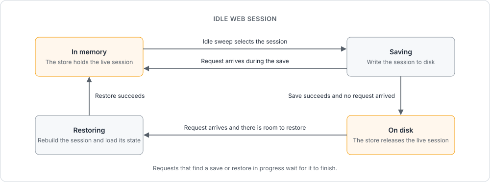

# Design of the web backend

This page explains how `composeui.webcore` handles requests, updates the browser, and manages
sessions. The user guide's
[Web backend](../user-guide/running-the-app.md#web-backend) section covers what users see.

For uploads, downloads, and streaming, see [File transfers on the web](web-file-transfers.md).

## The web backend

The web backend renders HTML on the server and updates the page with htmx.

- **The id is the rendered object.** The web has no live widget between two requests. A web
  renderer's rendered object is the id of its HTML fragment, `cui-{id(view)}-{role}`.
- **One main view per session.** Each browser session has its own main view, in a `WebSession`
  (`session.py`). `WebApplication.connect` records each connection, and connects it again on the
  main view of each new session.
- **Events go in, fragments come out.** An event goes to the server. The response sends back
  the fragments that the event changed, and htmx swaps them into the page.

## A button click on the web

This is the click of [A button click](architecture.md#a-button-click) on the web, step by step:

1. **The browser posts the event.** The button's fragment (`WebButtonRenderer.to_html`) has
   `hx-post="/_composeui/widget/{id}"` and `hx-vals` with `event=click`. Its `hx-swap="none"`
   tells htmx not to swap the button with the response.
2. **The middleware checks the request.** `create_starlette_app` in `webapplication.py` adds
   the middleware. `SecurityHeadersMiddleware` (`headers.py`) adds the security headers to
   every response. `BodySizeLimitMiddleware` (`limits.py`) refuses a body that is too large.
   `SameOriginMiddleware` (`origin.py`) refuses a request from another origin. Starlette's
   `SessionMiddleware` reads the signed session cookie.
3. **The route finds the session.** `widget_event` (`routes.py`) gets the session from the
   cookie's id. When the session is gone, or did not serve the page, the response has
   `HX-Refresh`. The page reloads, with the cookie's session or a new one. Otherwise, the
   route calls `WebSession.handle_event` in a thread: the app's callbacks are synchronous
   code, and must not block the event loop.
4. **The session dispatches the event.** `handle_event` finds the renderer by its id in the
   session's own `renderers`. An id of another session is not found. `_respond` takes the
   session's lock and opens `collect_dirty()`, a set of dirty renderers for this request. Then
   it calls `WebButtonRenderer.dispatch`, which refuses the click when the button is disabled.
5. **The signal runs the callback.** `dispatch` emits `clicked`. The callback sets
   `label.text = "Done"`.
6. **The label's renderer becomes dirty.** `notify_renderer`, the `on_setattr` hook of every
   view field, calls the renderer's `refresh_attribute("text", ...)`. The handler in the
   `_refresh_dispatcher` of `WebLabelRenderer` is `_mark_dirty`. It only adds the renderer to
   the dirty set: the renderer renders nothing yet.
7. **The session renders the dirty fragments.** `_respond` adds the renderers that a thread
   changed since the last response (`take_pending`) to the dirty ones. `render_dirty` calls
   `to_html(oob=True)` on each, which adds `hx-swap-oob="true"` to the root element. It drops a
   fragment that another dirty fragment contains, else htmx would swap it twice.
8. **The session adds the page's fragments.** When the event changed the main view's title,
   language, or running jobs, `_respond` adds their fragments too. When the event opened
   another page, `_respond` also returns the page's address.
9. **The route responds.** `_widget_response` sends the fragments as HTML. With a new page, it
   adds `HX-Push-Url`, which puts the address in the browser's history. When the app closed
   (the Exit action), it drops the session and responds with `HX-Redirect` to `/`.
10. **htmx swaps the fragments.** htmx puts each `hx-swap-oob` fragment in place of the element
    with the same id. The label shows "Done". The button stays as it is.

When the app has [reactive methods](architecture.md#reactive-methods), they run once `dispatch`
returns, in the batch that `_respond` opens around it, and before step 7. The fields that they set
mark their renderers dirty, as in step 6, so their fragments go out in the same response.

The other routes follow the same steps. `widget_file` gives an upload to the session in place of
a form. `jobs_poll` runs no event: its response sends the changes that the threads made.

## Requests and updates

- **htmx requests and responses.** The browser sends htmx requests to Starlette. Renderers build
  HTML without a template engine. `Markup.format()` escapes plain strings and preserves
  fragments already marked as `Markup`. Do not mark user input as safe HTML.
- **The renderers' modules.** `webrenderer.py` holds the base `WebRenderer` and the helpers that the
  renderers share, such as `_view_html` and the icons. Each family of renderers has its module in
  `_renderers/`: `inputs.py` (text, numbers, dates), `controls.py` (check boxes, buttons, sliders),
  `choices.py` (also the tree), `content.py` (labels, images, Markdown, consoles, logs, metrics, the
  notification, the status bar), `charts.py`, `graphics.py` (maps, drawings), `tables.py`,
  `files.py` (path fields, uploads, the server's files), `forms.py`, `actions.py` (menus, toolbars),
  `dialogs.py`, `containers.py` (rows, columns, panes, lists, tabs, pages) and `navigation.py` (the
  main view, its sidebar and router). A module holds one family: split one that starts to mix two,
  whatever its length. Such a module imports `webrenderer.py`. So `renderers.py`, not
  `webrenderer.py`, maps each renderer key to its class, written out, not discovered. The base names
  no renderer at run time: it asks each one, through `is_drawn_apart` (a dialog, drawn at the end of
  the page) and `shows` (a router's or a tab's page shown). A form row's label is always a
  `WebFormLabelRenderer`, which the base only casts to. When the base must treat a renderer apart,
  add such a hook with a default, not an `isinstance` check, which would tie that renderer to the
  base's module. `changes.py` collects the renderers that a request changes (`collect_dirty`), and
  `rendertarget.py` holds a session's view tree and its lock (`RenderTarget`).
- **No code in the markup.** The page's `Content-Security-Policy` (`headers.py`) runs script
  files only, and htmx runs without `allowEval`: no inline handler, `hx-on`, `js:` value, or
  trigger filter. A renderer marks its element (`data-post-event`, `data-close-dialog`, ...) or
  triggers on a custom event (`enter-key`, `escape-key`, `activate`), and the page's scripts do
  the rest (see [The page's scripts](#the-pages-scripts)).
- **Hidden fragments keep their id.** A hidden fragment's root keeps its id (`hidden`
  attribute), so a later swap has a target.
- **Updates.** When a rendered attribute changes, the renderer can mark itself dirty.
  `collect_dirty` records dirty renderers during a request or a handover from a worker thread.
  `render_dirty` returns out-of-band (OOB) swaps for their fragments that are in the page,
  even if they are hidden. It omits a fragment if another swap already includes it.
  `hx-swap="none"` prevents the normal swap, but an OOB swap can still replace the sender.
  A text field handles a user edit inside `stop_refresh()` to avoid replacing the field while
  the user types. If the user leaves a numeric field with text that does not parse, the
  renderer marks the field dirty so the response restores the view's value.
- **Changes from threads.** `call_on_main_thread` runs its callback under the session's lock,
  and keeps what it changed in the session's `pending`. They are sent with the next event's
  response or fetch (a full page drops them). While the main view's jobs run, the page's
  `cui-jobs` poller fetches `/_composeui/jobs` every `JOBS_POLL_MS`, which brings them. The
  server pushes nothing, so an idle page sends nothing. A response whose event starts or ends the
  jobs swaps the poller in, as it does the page's marker.
- **Choices of several values.** Each box of a check list posts its key and its state, not a
  flip, and the check-all box posts its state too. A post that arrives twice leaves the same
  choice, and a click on a stale page does what the page showed. The user's change swaps only
  the parts that it changes: the check-all box, the list, and a multi-combobox's summary. It
  never swaps the box clicked or the search field, which keep the focus. A post that changes
  nothing, such as one of a stale page, swaps all three back as the view is. The check-all box
  shows partly checked through `tables.js`, which reads `data-indeterminate`.
- **A drop-down list swapped while open.** When the app updates a multi-combobox, the response
  replaces the entire control.
  Each box has an id made from its key, so htmx gives it the focus back. But the dropdown is
  open only while the focus is in it, and a closed one's boxes take no focus. So `page.js` keeps
  it open through the swap with `dropdown-open`, on the element swapped out too: htmx gives the
  new element the old one's classes until it settles.
- **Ranges.** A range slider stacks two range inputs on one track, only their handles taking
  the pointer. The lower input draws the track and the fill between the handles, from the
  handles' positions (`--range-low`, `--range-high`), as daisyUI's fill only reaches one
  handle. The inputs count steps, so a decimal step needs no decimal arithmetic in the page.
  Each posts both positions, as the page shows them, and the server takes them by
  `RangeSliderMixin.moved`. While dragged, `page.js` stops a handle on the other. When the two
  meet in the upper half of the track, the low one goes on top (`data-low-on-top`): the high one
  can't move below it, so a press there moves the low one down. A date range is two date
  fields, each posting its end. The end that followed the one set swaps alone, never the field
  typed in.

## The page's scripts

- **One script per domain.** The scripts are files of `webcore/static/`, in the hashed
  addresses of `page.py`:
  - `page.js` runs in the `<head>`. It applies the theme before the body paints, and holds the
    common controls, the request and session headers, the post numbers, the protection against
    stale fragments, the loading of the libraries, and the `MutationObserver` that runs each
    script's work after a change of the page.
  - `tables.js` runs once after `page.js`, before the body: row activation, cell editing, the
    check-all box, a large table's scroll windows, and its clipboard.
  - `charts.js` loads with uPlot, and `maps.js` with deck.gl, once the page shows the first
    chart or map.
- **Classic scripts, no bundler.** Each script keeps its code in a closure, and shares only
  what the others use, under `window.ComposeUI`: `dispatch` from `page.js`, and the `sync`
  functions of `charts.js` and `maps.js`, which they add once loaded. `page.js` calls them
  from its observer.
- **The library, then the script.** `page.js` loads uPlot, then `charts.js` (deck.gl, then
  `maps.js`), one after the other. A failed load is forgotten, and asked again on a later change
  of the page, up to five times: never as the other file arrives. Once both are there, each
  change of the page goes to the script before any check that a chart is shown, so a chart
  swapped out is destroyed, and a map finalized.
- **A chart's bars.** The server places the bars: the JSON of a chart holds each bar series'
  offset and width (`ChartView.bar_slots`), and the room between two bars' x. A series of
  another kind takes no room, so a line stands at the categories, over the bars. Without
  categories, `charts.js` adds half of that room to each end of the x range, so that the first
  and the last bar show whole. It adds it only when the range is the whole data: uPlot runs a
  scale's range function on a zoom too, and a zoom widened at each draw would drift as the
  series change.
- **A chart's stacked bars.** The server sends each stacked bar series its bars' bases
  (`ChartView.stack_bases`), by the points it sends, and each y axis how far its stacks reach,
  which its range takes in: uPlot fits a series' own values, which the legend keeps. The bars'
  builder draws each from its base (its `y0` and `y1` facets), and the hover shows no dot on a
  stacked bar, which would stand at the series' own value. Textual's plotext has no base:
  each bar goes from 0 to where it ends, the stack's last series first, which the others then
  cover.
- **A chart's bounds.** `charts.js` wraps each scale's range function last, so that an axis'
  bounds (`Axis.minimum`, `Axis.maximum`) win over the bars' 0 and the reference lines. The x
  range keeps a zoom as the user made it, which uPlot also asks the range function for. The
  zoom kept across a swap, and the image's address, take the whole data at the bounds for no
  zoom.
- **A chart's times.** A time axis' values are seconds since 1970, in UTC, on every backend.
  The page shows them in UTC whatever the browser's time zone: uPlot's `tzDate` and the legend
  read them as `Etc/UTC`. So a naive `datetime`, which the core takes as UTC, shows as the app
  wrote it, as Qt (`DateAxisItem(utcOffset=0)`), Textual and matplotlib show it. The server
  sends how precise the times are (`time`: `day`, `minute` or `second`), which the legend shows.
- **The order of the listeners.** Listeners of one event and phase run in the order they were
  added, and `tables.js` adds its after all of `page.js`'s. `page.js`'s captured Enter
  dispatches `activate`, which selects a row, before `tables.js` activates it. A cell's Escape is
  captured: else the sidebar's Escape in `page.js` would first move the focus, and the cell
  would post the text typed.
- **Types without Node.** The scripts carry JSDoc types. `make js-check` checks them with
  TypeScript's compiler, a binary, in strict mode, with `noUncheckedIndexedAccess`: an element
  read from an array or a map may be missing (`js/tsconfig.json`). `js/composeui.d.ts` declares
  the globals, the JSON of a chart and of a map, and the events of htmx; `make web-deps`
  downloads the declarations of htmx and uPlot beside it. deck.gl's bundle has none: its
  classes are unchecked. A JSDoc cast, such as of `event.target`, is not checked: it says what
  the page holds.

## Tables on the web

- **A large table's frame.** `WebSourceTableRenderer` draws a window of rows between two filler
  rows (`style` heights, which the policy allows) that give the scroll bar every row's height.
  `tables.js` posts the first row shown once the scroll stops outside the window. Only the
  `<tbody>` comes back (in a `<template>`, as a table's parts), so the scroll position stays.
  Browsers cap an element's height: past `SOURCE_TABLE_SCROLLED_ROWS`, a filler's row height
  stands for more than one row. The page maps the scroll position through the fillers as drawn,
  and posts the row under the headers with its offset. The server sizes the filler above the
  new window so that this row stays there, the frame's height kept. A new order swaps the whole
  frame, back at the top.
- **A table's parts.** A sort, a search, or a filter swaps only what it changes (the headers'
  row, the `<tbody>`, the count, the filter bar), never the search field being typed in. The
  bar goes last in the response: it may hold the element that sent the request (the filter
  editor's form), and htmx swaps no fragment after that one is gone. The `<tr>` and `<tbody>`
  go each in a `<template>` of its own: bare, they switch htmx's parsing of the whole answer to
  a table's rules, which mangles the fragments after them. An invalid filter value swaps only
  its message, which `syncInvalidFields` marks the field by.
- **A check-all box posts its state.** A click does what the page showed, partly checked to
  checked, not what the server would decide from its own rows, which a stale page may not show.

## Order and sessions

- **Order.** The server handles a page's posts in the order that the page sends them
  (`order.py`). Without it, a field's value, posted as a click on a button blurs the field, can
  reach the server after the click. `page.js` sets a page id and a number on each post in
  `htmx:beforeSend`. The routes await its turn on the event loop, no thread held, for at most
  `ORDER_TIMEOUT` (2 s) for a post that never comes. Scroll windows (`hx-sync="this:replace"`)
  carry none: one that is replaced may never be sent. A session keeps the order of `MAX_PAGES`
  (32) pages. Save's form (`cui-save`), submitted without htmx, carries no header: `page.js`
  sets its hidden `page` and `post` fields as it is submitted. Holding the posts back in
  `page.js` fails instead: htmx drops a held request whose element a swap has since replaced,
  and gives no promise to wait on for a trigger's request.
- **Sessions.** A signed cookie maps to a `WebSession`, which holds its renderers by id and an
  `RLock` (the timers of the status bar and of the notification take it through
  `call_on_main_thread`). A request whose session is gone answers `HX-Refresh`. The tabs of a
  browser share one cookie. So a tab left open on a page of an ended session sends the cookie of a
  newer tab's session. The session ended when the server restarted, or when it expired. The newer
  session doesn't have the views of the page. Worse, `id()` can give one of its views an id that the
  page shows. So each page names its session's `page_tag`. `page.js` sends it with each htmx request
  (`X-ComposeUI-Session`), and Save's form in its `session` field. `_session` in `routes.py` answers
  a request with another tag as if its session were gone. A plain link, such as a download, sends no
  tag and is not checked: it only reads.
- **The browser's id** (`MainView.browser_id`). The session cookie holds it beside the session
  id, under `BROWSER_KEY`. It lasts `browser_ttl`, or `session_ttl` if longer: a session ends
  with its cookie. It lasts at most `MAX_COOKIE_AGE` (400 days), the most that a browser keeps
  a cookie, which also takes an endless `session_ttl`. One cookie rather than two: two cookies
  could part, one cleared or expired while the other stays. The id is a random value of its
  own, made as a session is built, so that showing it gives no session. `routes.py` gives it to
  the main views that a request builds or wakes (`building_for_browser`). It makes the id only
  when one is built, so a request that builds none, such as a poll, sets no cookie. New and the
  check of a study build their initial view for the same id (`MainView._initial_view`): an app
  that reads it as its view is built would read the server's account instead.
- **Idle sessions on disk** (`session_idle`). The `SessionStore` tracks four states: in memory,
  being saved, on disk, and being restored.

  

  1. **Save.** The lifespan's sweep runs `hibernate_idle` in a thread. It saves one idle session
     at a time. `save_to` writes `<id>.partial`, then the store renames the directory to `<id>`.
     If the process crashes before the rename, the next process that reads the directory
     removes the partial one.
  2. **Wait for a save or restore.** A request that finds either operation in progress waits.
     If a request arrives during a save, the store keeps the session in memory and removes the
     saved directory, unless it is in a session folder, where the save stays as a copy. Async
     routes look up sessions that are not ready in the thread pool (`_session_off_loop`).
  3. **Restore.** `get_or_create` decides under the store's lock whether to find, restore, or
     create a session. If there is no room to restore a session, the store refuses the request.
     It does not create a replacement that would take over the old session's cookie. The store
     rebuilds the session outside its lock, and `open_saved` loads the saved state. The session
     gets a new `page_tag` because `id()` does not preserve widget ids. When a widget POST sends
     the old tag, its route responds with `HX-Refresh`, and htmx reloads the current page.
     A plain link, such as a CSV export or a chart image, sends no tag. After a restore, the old
     widget id can return 404. Reload the page to get the new link.

  **Lock order.** The sweep calls `WebSession.can_hibernate` with the session's lock held.
  It releases that lock before it takes the store's lock. `_drop_expired` takes the locks in
  the opposite order.

  **Active requests.** `held()` keeps a session in memory during work outside its lock,
  such as reading an upload or streaming a CSV. The session's idle time starts when the last
  such request ends.

  **Save conditions.** A new large-table source prevents a save if the app set it after the
  last `loaded`. The session records these sources after a request that emitted `loaded`,
  including its reactive methods. It also records them after `open_saved` and Open.
  The save includes the initial state for comparison with changed code (`code_edits`) only
  when the store uses a `--reload` server's directory or a session folder. Otherwise the same
  code opens the state. A field whose default changes on every build, such as a date, could look
  like a code edit.
- **Sessions in a folder** (`session_folder`, `SessionFolder` in `session.py`, the files in
  `sessionfolder.py`). The store saves into the folder as it does for `session_idle`, and keeps
  the sessions in memory there as the server stops (`keep_all`). It makes no copy of a session
  in memory: a crash loses those, as without a folder. Copies for crashes were tried and left
  out: their uploads, times and places each needed rules of their own.
  - **A folder of its own.** `claim` refuses a folder that holds no `secret-key` but other
    files than a server that stopped as it started leaves (`lock`, `secret-key.partial`): the
    start would remove them. In its own folder too, the store acts only on the names it gives:
    a session's id, with `.partial`, and `uploads/composeui-*`.
  - **A lock for each serving.** `open_folder` locks `lock` (`fcntl.flock`, `msvcrt.locking` on
    Windows) before it reads the folder: a second server would remove the partial saves that
    the first one is writing. The store takes it as it's made, for the key that the cookie's
    middleware needs, and the lifespan takes it again at each start after a stop, reading the
    folder again. A server that fails to be made, e.g. on a missing stylesheet, releases it
    (`close_folder`). The system releases the lock when the process ends, even killed.
    `keep_all` releases it once the job threads of the sessions it closed have ended
    (`Jobs.after_workers`): their uploads, in the folder, go only then, and the next server's
    start would take them for a crash's. On Windows, the release unlocks first: Windows releases
    the lock of a closed file only after a delay.
  - **The key.** `secret-key` holds the cookies' key, written once, beside it, then renamed, with
    mode 0600. An empty key stops the server: it would sign cookies that anyone can make.
    `_SteadySigner.unsign` takes a cookie signed later than its clock, as one a previous
    server signed before the clock stepped back: the key proves it, `max_age` and the session's
    own idle time still end it.
  - **Plain saves.** A folder's saves don't hold the views' initial values (`code_edits` off),
    as hibernation's: that check builds a main view of its own (`build_initial_view`), whose
    fields may start with new values at each build (a date). After an edit of the code, a save
    that no longer fits is dropped.
  - **The stop.** `keep_all` drops the expired sessions first, then saves each live one through
    `can_hibernate`, within `max_saved_sessions` on disk. A place counts once its save is there:
    one that can't be saved leaves it to the next. With no room, it checks `can_hibernate` only
    to log the loss, and a failure of the app's check is logged too. A model that fails to close
    is logged, and the next sessions are still saved.
  - **Times.** Each save holds the clock time of its session's last request (`last-seen`,
    written in the save before it takes its name). The next process turns it into its own
    `time.monotonic`, so a session idle for `session_ttl` while no server ran expires at the
    first request. A clock set back counts as no time passed. One unreadable counts from the
    save's own time, never later than its last use.
  - **A failed wake.** A session whose build fails, the app's code failing maybe for a while,
    goes back on disk for its next request. One whose save fails to open is dropped, there as
    without a folder: its next request starts anew, rather than fail again.
  - **Uploads.** A path field's, an upload view's or a table cell's uploads go to
    `uploads/composeui-*` in the folder, not to the system's temporary folder, which a new
    container or a reboot empties. `_saved_uploads` owns only a directory there, so a save that
    names another one, such as another server's in the temporary folder, never deletes it. A
    session that wakes holds again the upload of each field that its saved path or files name
    in that directory (`_hold_saved_uploads`), under the field's new widget id, so the field's
    next upload removes it. The upload's folder must be one made for that kind of field (its
    widget id's last part), and no other field may name it: a path that the user copied from
    another field, or from a table's cell, would else be removed with the field's next upload.
    An upload view whose saved files are elsewhere, or gone, holds none. At start, the store
    removes the directories that no save names: those of the sessions in memory that a crash
    lost. A file arrives in the temporary folder first, and is moved there once whole. The store
    makes the folder's path absolute, so the uploads' paths are too: before Python 3.12,
    `mkdtemp` gives a relative path in a relative folder.

## Pages, tabs, and dialogs

- **The backend's own addresses** are under `/_composeui/` (`INTERNAL_ROUTE`), one `Mount` in
  `create_starlette_app`, and the pages have the rest. So a page can take any other name, and a
  new route of the backend does not take a name from an app's pages. A page's route can't be
  `_composeui` (`check_routes`).
- **Pages and tabs.** The router sends only the shown page. A change on another page is not
  sent: the page brings it once shown, as navigating swaps the router. Tabs send only the shown
  tab's views, and the other panels stay empty. The browser shows the tab picked at once. Then
  the answer to its post fills the tab picked and empties the tab left.
- **Pages and tabs built once shown.** As Qt does, the router and the tabs build the views of a
  page or a tab the first time it shows: by an address, a link, a tab picked, or the app's code.
  Each session of an app with many pages then takes less memory, and its first page comes
  sooner. A page or a tab not built has a renderer of its own, without its views. Until it's
  built, it adopts the dialogs inside it, which the app opens whatever is shown, so they follow
  its enabled state. A post to a view not built finds no widget in the session, and is refused
  as any unknown widget is.
- **Dialogs** render at the end of the page, outside the shown page's slot: a page not shown
  is not sent, and would take them with it. The browser opens a modal `<dialog>` only from a
  script: `page.js` opens each one swapped in shown, once. A button closes its dialog in the
  browser first, so the focus returns where it was, then posts its answer. The server swaps it
  closed.

## The header, icons, and images

- **Header.** A web app's header, not a desktop menu bar: File's New, Open, and Save are buttons
  of their own (Save As and Exit left out). Any other menu is a drop-down under its title, marked
  with a chevron so it reads apart from the buttons. A `ToolBar`'s buttons go before the menus.
  A drop-down is as wide as its longest item, the shortcut a faded hint beside it. On a phone,
  the buttons with an icon keep only their icon, and the app's title is cut short. So the header
  holds on one line. The pages' toolbar has a row of its own.
- **A button with a menu.** A `MenuButtonView` is the header's drop-down in a page: its entries
  are the menu items that `WebActionRenderer` draws, and its renderer adopts them, so the server
  refuses an entry of a disabled or hidden button. daisyUI's drop-down opens from the button's
  left edge and never flips, and the renderer doesn't know where the row puts the button. So
  `page.js` measures the list each time it opens (`data-fit-dropdown`), and opens it from the
  button's right edge instead where the window is too narrow, as at a row's end on a phone.
- **Notification.** The main view's `notification` is drawn above the page's card, not in it:
  it isn't the page's content. It is sticky below the header, so a long page doesn't scroll it
  away. Its close button posts the number of the message it shows (`NotificationBar.number`):
  a job's callback can replace the message before the page shows the new one, and a close of
  the old one must not close a message that the user never saw. The same message shown again
  keeps its number. An information fetches the bar again after its timeout, as the status bar
  does.
- **Icons.** An action's `icon` is a file path, as Qt reads it: `icons.py` serves the file at
  `/_composeui/icon/<digest><suffix>`, an address naming its content, cached for good. Only
  image files that a view has named are served, and `icon` is never loaded from a study, so no
  request can name a file. An SVG is drawn as a CSS mask in the text's color, so it follows the
  theme like the built-in New, Open, and Save icons. Another image shows as it is.
- **Images.** An `ImageView` has its own route, `/_composeui/widget/{id}/picture`, that answers
  its session only: an image can be private, so it stays out of the process's registry of icons. A
  `data:` address would send it again with each swap. The address names the content by its digest,
  so a browser can keep it, and an older digest answers 404, never another image. The route serves
  only what starts as an image, as an app may set a path that a user typed. `image` is never
  loaded from a study, as `icon` is not.
- **Drawings.** A `DrawingView` is SVG that the server makes from validated shapes, with no
  script. The element keeps the proportions of `bounds`, so a percentage of it places a point.
  Each shape is in a nested `<svg>` with a `viewBox`, which clips it to `bounds`, and its stroke
  does not scale. A text, an arrow head, and a dimension's ticks stand at a percentage and are sized
  in pixels, so they keep their size. They stay outside the nested `<svg>`: a text near the edge
  is not cut. Only the browser knows the scale on the page, so an arrow's line stops inside its head
  by a length computed at the largest size that the view can have.
- **An app's look.** A `WebStyle`'s theme is a stylesheet that `style.py` writes as the server
  starts, served at `/_composeui/style/theme.css` by its digest, as the page's policy refuses a
  `<style>` element. It sets daisyUI's variables under the selectors of ComposeUI's own themes in
  `css/app.css` and loads after it, so it wins by order, not by a new theme name. So the Theme
  menu, the browser's preference and a chart's image (`data-theme="composeui"` in `charts.js`)
  need no change. The app's stylesheets are read and checked once, there too: an `@import` or a
  `url(...)` that the folder doesn't serve stops the server, as the browser would drop it without
  an error. The folder's route serves only stylesheets, fonts and images, never a hidden file or
  one out of the folder. The stylesheets' addresses name no digest, and the route answers
  `no-cache`: a file edited while the server runs shows at the next page, unchecked until the
  server starts again. Each part of the page carries a `data-cui`, its renderer's `_role` for a
  widget, set by `_root_attributes`: the hooks that an app's stylesheet selects, which stay when
  the classes change. The contrast
  check judges only the pairs that a palette sets: ComposeUI's own light palette has four pairs
  below 4.5:1 (secondary, info, success and error).
- **By design:** `Menu.is_visible` is ignored (a drop-down is always shown). An action's `data`
  is not displayed. Ctrl shortcuts become Alt+Shift. An unknown page address is a 404, not a
  redirect: browsers ask for addresses of their own, like `/favicon.ico`.

## Testing the web backend

Tests drive the examples over HTTP with Starlette's `TestClient`, in `tests/webcore/`: a module
per family of `_renderers/` or per other module of `webcore`. The behavior that only a browser
shows (the caret, shortcuts, the `aria-invalid` sync, the offline page, history, opening
dialogs) is in `tests/test_browser.py` (`make browser-test`).
