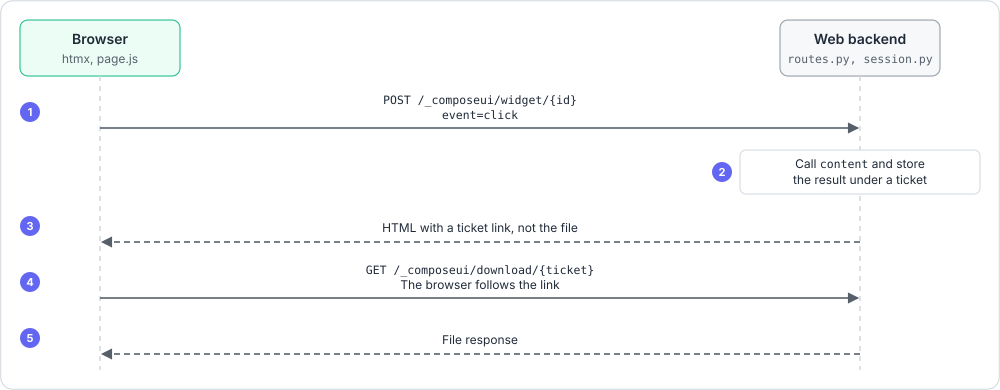

# File transfers on the web

This page explains how the web backend receives uploads and sends downloads. It also covers how
the Open and Save actions transfer a study file. For request order and session lifetime, see
[Order and sessions](web-backend.md#order-and-sessions).

## Uploads and Open

- **Uploads.** `widget_file` reads the multipart body itself (`uploads.py`), not through
  Starlette's form parser, whose spooled file a route can only copy. The body goes to a scratch
  file with no lock held, and `WebSession.pick_file` moves that file. A file over the limit
  keeps being read, to answer in the status bar, but stops going to the disk. Open still reads
  through Starlette: a study is small. A replaced upload stays until `jobs.is_running` is false:
  nothing says which file a job reads, and a job may not have opened it yet. Holding a file
  through the app's code would bring the same failure back each time an app forgets.
- **Several files at once.** The receiver writes each file part to its own scratch file. It
  keeps what a chunk brings by part, because one chunk can end a file and start the next one.
  `max_upload_size` counts the bytes of all the parts. `WebSession.pick_files` gives several
  files only to a `FileUploadView` with `multiple`; any other widget refuses them (400), as
  its page never sends them. A `multiple` view gets one file this way too, so its names do not
  depend on how many files came. The files keep their own names when every system can hold them
  (`_own_name`), because a file can name another one. Two names that one folder cannot hold
  apart (case, or composed and decomposed accents) refuse the choice. The files go to a new
  folder, which the field holds only once all of them are there. A move that fails removes
  that folder, and the field keeps its previous files.
- **An upload in the app's folder.** With `upload_folder`, `_keep_in_folder` takes the name
  first with an empty file opened exclusively, so two sessions never share it. A name that a
  table's cell holds counts as taken, even with its file gone: the same text would reach the
  cell, and no edit would say that the file changed. The file is written beside the name, then
  replaces it. The session never tracks the file. It deletes it only when no cell holds its
  path at the end of the edit, since the app would never learn of it. A path with
  `server_roots` refuses any upload, because its page sends none and a crafted one would write
  in that folder.
- **A long upload and the order.** A file's post takes its turn (`order.py`) once its whole body
  has arrived, so a later post runs first after `ORDER_TIMEOUT`. Waiting for the upload would
  hold every click for as long as the network takes. So `page.js` marks only the upload's own
  button, and the docs say that a click does not wait.
- **Open** applies an upload to a scratch instance first (core's `load_state_data`), so a bad
  file never half-loads. Responses send `Cache-Control: no-store` and controls set
  `autocomplete="off"`, so a reload always shows the server's state.
- **Open over unsaved changes.** The browser's picker sends the file at once, so the question
  comes after the upload: `WebSession.load_state` keeps the file's bytes in the dialog's pending
  call (at most `MAX_STATE_SIZE`) until the answer, a post of its own. A second upload replaces
  them. A session that asks doesn't hibernate (an open dialog), so the bytes never need saving.
  A file of another type, or too large, is refused before the question.
- **Save and download a study.** The Save form sends `POST /state/download` without htmx.
  The response contains the study file, and the session marks the study as saved. `GET /state`
  downloads the study without marking it as saved. A link can request the file without an
  explicit Save action, and the user may never get the file.

## Downloads on the web

Unlike the Save form, `DownloadView` sends its POST through htmx, which reads the response
for page updates. The POST does not return the file. Instead, the session gives the browser
a link with a ticket. The browser follows the link to receive the file.

### Download steps

The diagram shows the default path, where `content` runs during the POST.

1. A click on a `DownloadView` sends an htmx POST. By default, `content` runs during the POST.
   With `in_job`, the POST starts a job that runs `content`. In both cases, `MainView.download`
   passes the result to `WebMainRenderer.download`. The app can also call `MainView.download`
   directly.
2. The session keeps the file under a ticket: 128 random bits (`webcore/downloads.py`).
3. Event responses, the jobs poll, and the full page list tickets not yet fetched.
   `downloads_marker` adds a link per ticket in `#cui-downloads`.
4. `page.js` follows each ticket's link once (`startDownloads`): `GET /download/{ticket}`.
5. The GET serves the bytes or file on disk. For a `StreamContent`, it runs `write` instead.
   The GET does not call `content`.

### Ticket lifetime and limits

| State | Request | Expiration | Limit exceeded | Session ends |
| --- | --- | --- | --- | --- |
| Bytes or a path, not fetched | The first GET or HEAD serves the file or its headers and marks the ticket as fetched. | 10 minutes after creation (`DOWNLOAD_TTL`). | Drop the oldest ticket. | Drop the ticket. |
| Bytes or a path, fetched | A GET or HEAD can use the ticket again until it expires. | 1 minute after the first fetch (`FETCHED_TTL`). | Drop the oldest ticket. | Drop the ticket. |
| Stream, not claimed | The first GET claims the ticket and removes it. A HEAD returns headers without claiming the ticket. | 10 minutes after creation (`DOWNLOAD_TTL`). | Drop the oldest ticket. | Drop the ticket. |
| Stream, claimed | Another GET or HEAD returns 404. | No ticket remains. | No ticket remains. | Cancel the writer. |

A stream's HEAD response has no `Content-Length`.
The store checks expiration when it adds, looks up, or lists tickets.

- **Listed until fetched.** A response can be lost, for example when the browser reloads
  the page. The next response with a download marker lists the ticket again if the browser
  has not fetched it. `page.js` remembers which links it already followed.
- **Available after the first fetch.** A browser's download manager may send a second request
  for a file or its headers. The first fetch starts the shorter timeout. Later fetches do not
  extend it.
- **Limits.** Each session keeps at most `MAX_DOWNLOADS` tickets, including those for a `Path`
  or a `StreamContent`. `MAX_DOWNLOAD_BYTES` limits only the bytes kept in memory. Dropping a
  ticket for a `Path` does not delete the file.
- **Missing file or session.** The GET returns 404, not a redirect, so the browser does not save
  a page as the file. The link's `download` attribute keeps the current page open.

### Streaming

The app creates a `StreamContent` during the POST, in a job, or in its own code. If the writer
needs data from a view, read it before passing the `StreamContent` to `MainView.download`.
The download uses a ticket, like a file on disk. During the GET, `webcore/streaming.py` runs
`write`, which uses the data the app captured.

- **The writer must not read views.** ComposeUI does not enforce this rule. It is part of the
  `StreamContent` contract. A generator would not read the views when created. It would run when
  the GET reads its pieces, so the values in one file could come from before and after an edit.
- **Session and ticket.** A request must have both the session and its valid ticket to start the
  writer.
- **Once.** The first GET takes the ticket (`Downloads.take`): a writer can't run twice, and a
  second fetch answers 404. A `HEAD` doesn't take it.
- **A thread of its own.** `write` runs on a daemon thread. A long export would otherwise take
  one of the 40 threads that synchronous routes share in AnyIO's pool. The stream does not hold
  the session's lock while the writer runs.
- **Backpressure.** `DownloadSink` gathers the writes into pieces of 256 KiB
  (`DOWNLOAD_CHUNK_SIZE`), and cuts larger ones. The writer waits on a `threading.Condition`
  while 1 MiB (`MAX_QUEUED_BYTES`) waits to be sent. The answer reads the pieces on the event
  loop, woken by `call_soon_threadsafe`: it never blocks the loop. uvicorn waits for the socket
  to drain, so a slow browser slows the writer.
- **Cancel.** A browser that leaves, or the session's end (`WebSession.close`, through
  `streaming`), cancels the stream: the writer's next write raises `DownloadCanceledError`, and
  every one after. The answer then waits for the thread before it frees the session and its
  place, whatever cancels it meanwhile (`Stream.ended`): an anyio shield stops anyio's cancels,
  not asyncio's `task.cancel`, which uvicorn and then `asyncio.run` send as the server stops. A
  writer that doesn't write for a while holds them that long.
- **A server that stops.** uvicorn's graceful shutdown waits for the open answers before the
  lifespan closes the sessions, and tells the app nothing. So `run` gives uvicorn
  `WebSettings.shutdown_timeout` as `timeout_graceful_shutdown`, which the processes of a
  `--reload` server get too. Past it, uvicorn cancels the answers, and their `finally` cancels
  the streams. A writer that doesn't write still holds the stop until its next write.
- **Errors.** The answer waits for the first piece before it sends its headers. A writer that
  fails before it gets a 500, and the error is logged. One that fails after it raises
  `StreamFailedError`, which breaks the connection: the browser shows a failed download, not a
  short file.
- **Limits.** At most `WebSettings.max_download_streams` streams run at once on the server,
  and `max_session_download_streams` for one session (`StreamPlaces`, AnyIO `CapacityLimiter`s);
  the next wait. A stream takes its session's place first: one that waits for it holds none of
  the server's, so one browser that reads slowly can't take them all. A client that opens many
  sessions still can, as for `max_sessions`. The waiting answer notices a browser that left
  only at its first piece.
- **Held.** The answer holds the session (`held`): it isn't saved to disk, and doesn't expire,
  while the file is sent. A session is idle from its last request's end (`_Entry.is_expired`).
  The GET takes the ticket before its answer holds the session. The lookup of the GET counts as
  a request, so only a `session_idle` shorter than that gap could save the session meanwhile;
  the stream would then answer 404.
- **Not compressed.** `GZipMiddleware` would compress each piece on the event loop. The app's
  downloads (`/download/`) skip it, the bytes and the files too.

### Why use POST and GET

The POST handles the click. `SameOriginMiddleware` checks its origin, and `PostOrder` waits
for earlier numbered POSTs, up to `ORDER_TIMEOUT`. A GET triggered by a click would not have
either check by default. A top-level GET from another site can carry the session cookie
(`SameSite=Lax`). It must not run a callback that changes the app, such as marking a study
as exported. An unnumbered GET could also run before a field edit that the page just sent.
The numbered Save form also waits up to `ORDER_TIMEOUT` for earlier POSTs. If the wait times
out, Save can continue before a missing POST arrives.

A ticket also lets a job or a direct call to `MainView.download` deliver a file when there is
no click response to carry it. The browser fetches all three kinds of download in the same way.

Letting a click stream directly from a GET would need separate checks and would still need
tickets for jobs and direct downloads. That alternative would require:

1. The origin check used for POSTs (`is_same_origin`).
2. A request number in the same sequence as the page's POSTs.
3. No HEAD or prefetch (`Sec-Purpose`), and a `<button>` rather than a prefetchable link.
4. The `takes_events` check.
5. A lock on the session for each read, as in `table_csv`.
6. A connection that closes if the writer fails after sending part of the file.

This would save one round trip only for clicks without `in_job`. Locking each read separately
would still allow the writer to read view values from before and after an edit.
